# Live performance UX: research and five designs

**Written:** 2026-11-21, against `master` at `979c6c8`. Vibe Phases 1–8 and zones Z0–Z6 have landed.
**Status:** Design exploration, for you to choose from. Nothing is built, and nothing here is a plan yet. Once a direction is picked, it gets a plan in the usual format (`.agents/rules/planning-guide.md`). **Round 1** (§1–§5) works inside the existing app. **Rounds 2 and 3** (after §5) invent new ways of playing light, based on how music is perceived and felt. Three instruments remain: F, G and L.

## Start here

You asked for research on live-performance and music-app UX, and for several designs, with mockups, that ease the pain points you've raised. This folder has:

1. **Five research notes** (`research/`), written in parallel. They cover laser and lighting software, VJ and DJ software, music instruments and apps, HCI for live performance, and rig setup and spatial mapping. Every claim has a source link.
2. **The pain points P1–P8**, with evidence from screenshots of the app as it is today (`designs/00-pain-points.md`, `mockups/today/`).
3. **What the research agrees on**: 14 findings that came up in three or more notes (`designs/02-research-synthesis.md`).
4. **One shared design language** that every design uses (`designs/01-design-language.md`, below).
5. **Five designs**, A–E, each with 3–4 mockups and a short doc (`designs/A-…E-…md`, `mockups/a1…e3`).

**Short version:** the designs are not rivals. Each one is strongest on different pain points. The best result is probably a mix of them (§4). The biggest gains for the least work are:

- **A**: a Perform tab that explains itself.
- **C**: grouping by *where you put a cue*.
- **E**: setup and safety drawn on a picture of the stage.

**D** (the co-pilot) and **B**'s NEXT preview are bigger bets.

## 1. The pain points (P1–P8)

| | Pain point | Today, in one line |
|---|---|---|
| P1 | Busking with ≤ 5 buttons, 1–2 faders, in the dark | the five pads exist, but they all look alike and don't say what they'll do next |
| P2 | Grouping cues must be quick to set up and easy to use | the Vibes tab works, but has six sub-tabs, two side panels and eight cut-off labels |
| P3 | Presses should move effects, and you should see what reacts to what | the tap reactions exist; on screen they are a line of text |
| P4 | Multi-laser setup is one of the worst parts | ordering lasers now builds the groups, but the strip is 1-D, cramped, and full of jargon |
| P5 | Cues shouldn't know the rig; zone chase, swap and shift live | built (zones, maps, patterns, step grid); it's hard to see which one is moving the picture |
| P6 | The screen must tell the truth | mostly fixed; Perform still shows four "No Preview" boxes instead of the real lasers |
| P7 | Too many concepts | about 20 words to learn: vibe, pool, bed, FX set, reaction, zone, map, lane, pattern, split… |
| P8 | Safety | the features are built; the show lock is a small button, and safety zones only show in an inspector |

Details and evidence: `designs/00-pain-points.md`.

## 2. The shared language (every design uses it)

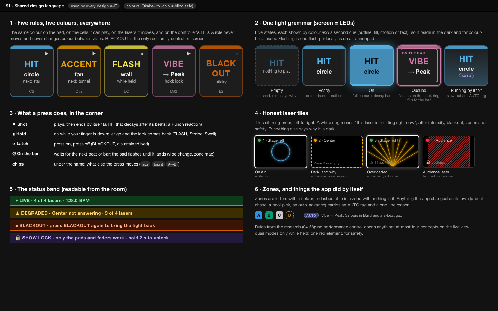

- **Five colour-blind-safe role colours** (Okabe–Ito), the same on every tab and on controller LEDs.
- **One light grammar, on screen and on the hardware.** The states are empty, ready, on, queued (flashes on the beat) and running-by-itself (tagged AUTO).
- **A press glyph** in each pad's corner: ▶ shot, ▮ hold, ⟳ latch, ⏱ on the bar.
- **Honest laser tiles:** shown in rig order, with a white ring only when the laser is really emitting, and a reason whenever it is dark.
- **A status band readable from the room:** LIVE, DEGRADED, BLACKOUT or SHOW LOCK.

Even without any of the designs below, this sheet alone addresses part of P1, P6 and P8.

## 3. The five designs

| | Design | One-line idea | Best for | Size |
|---|---|---|---|---|
| **A** | [The Instrument](designs/A-instrument.md) | Perform explains itself. Each pad shows its press type, what plays, what's next and what it moves. Real lasers replace "No Preview". Hold **?** to see a pad's back; **Tune** flips the pads over to edit them in place | the five-button busker; the smallest step from today | 6–7 wk (≈ 5 without Tune) |
| **B** | [Now & Next](designs/B-now-next.md) | Two decks: NOW is on air, NEXT is cued and previewed but not sent. One VIBE tap takes NEXT on the bar. Vibes are *crates*: drop cues on one and the roles fill themselves | performers who plan ahead and hate surprises | ≈ 8–9 wk (first cut ≈ 3) |
| **C** | [Set Grid](designs/C-set-grid.md) | The whole set is one grid. Each row is a vibe and each column group is a role, in its colour. You group a cue by putting it in a column. It mirrors 1:1 onto a Launchpad | building sets fast; seeing everything at once | ≈ 5 wk |
| **D** | [Co-pilot](designs/D-co-pilot.md) | The app plays a sensible show from the beat and the phrase, and you steer. HIT and ACCENT add on top, holding VIBE freezes it, and fader 2 becomes Energy. Every automatic move is tagged, explained and logged | long sets, and doing two jobs at once | 6–10 wk |
| **E** | [Stage view](designs/E-stage-view.md) | The main picture is the stage seen from the audience, with every laser where it hangs, drawing what it draws. You set up, check safety and play zone effects on that one picture | multi-laser rigs, touring, audience scanning | ≈ 9 wk |

### A · The Instrument
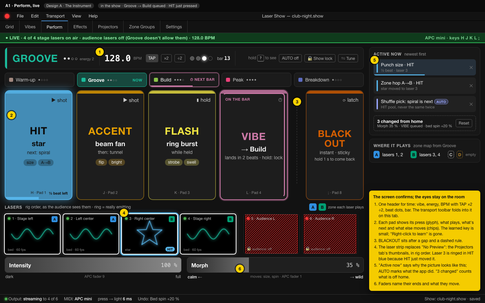
More screens: [A2 hold to see](mockups/a2-instrument-hold-to-see.png) · [A3 Tune mode](mockups/a3-instrument-tune-mode.png) · [A4 controller mirror](mockups/a4-instrument-controller-mirror.png)

### B · Now & Next
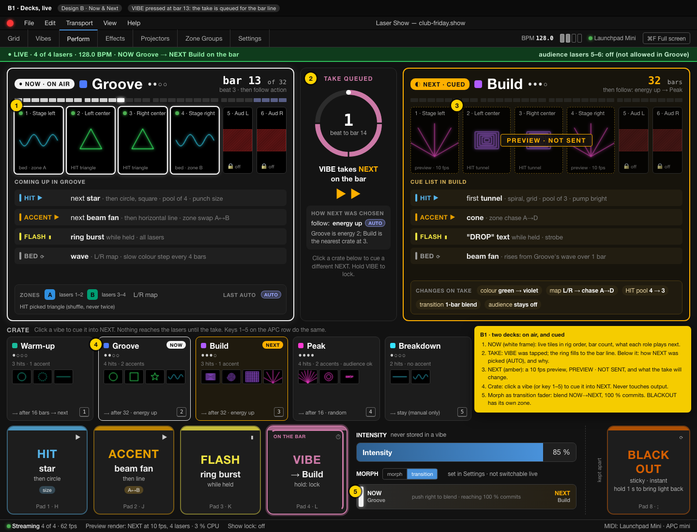
More screens: [B2 crate builder](mockups/b2-decks-crate-builder.png) · [B3 transitions and blind edit](mockups/b3-decks-transitions.png)

### C · Set Grid
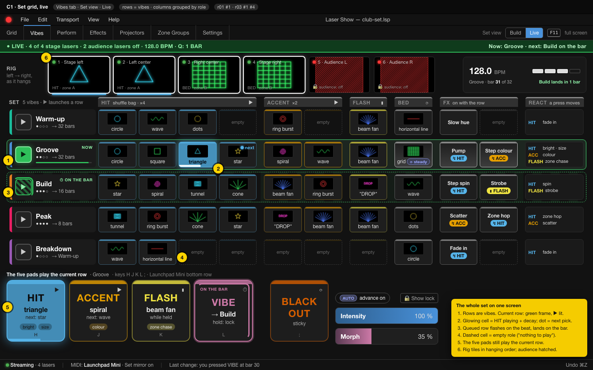
More screens: [C2 building a set](mockups/c2-setgrid-build.png) · [C3 Launchpad mirror](mockups/c3-setgrid-launchpad.png)

### D · Co-pilot
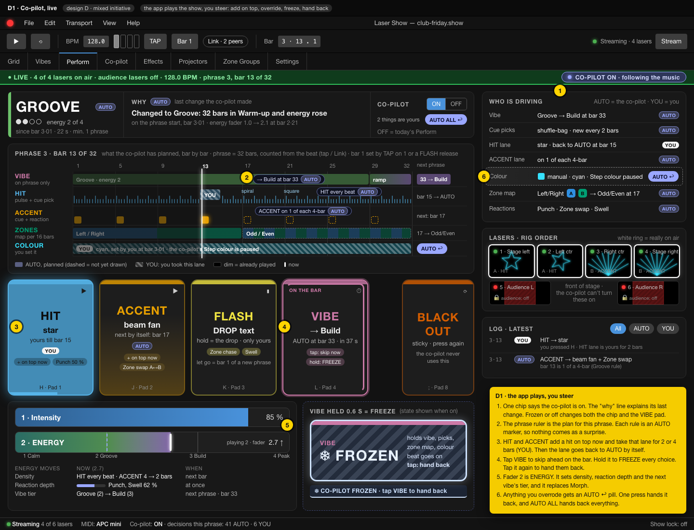
More screens: [D2 energy sort](mockups/d2-copilot-energy-sort.png) · [D3 rules and the log](mockups/d3-copilot-rules-and-log.png)

### E · Stage view
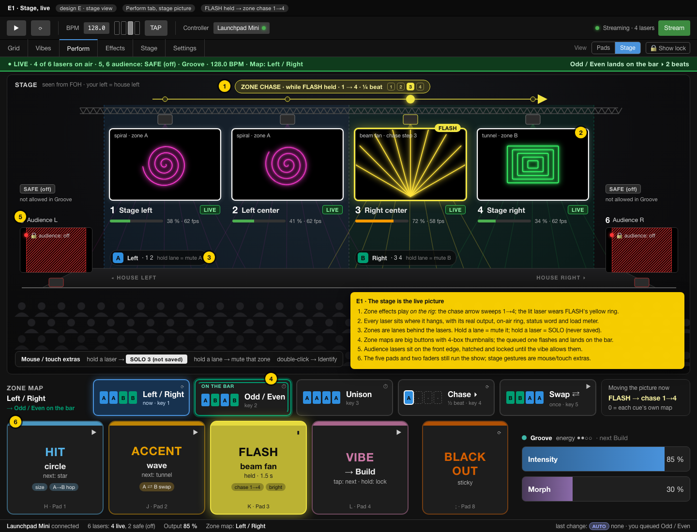
More screens: [E2 rig walk](mockups/e2-stage-rig-walk.png) · [E3 safety and roles](mockups/e3-stage-safety-and-roles.png)

### How they compare

Each design rated itself, and the ratings were checked against the mockups. ● strong · ◐ partial · ○ not addressed.

| | A Instrument | B Now & Next | C Set Grid | D Co-pilot | E Stage view |
|---|---|---|---|---|---|
| P1 busking load | ● | ● | ◐ | ● | ◐ |
| P2 easy grouping | ◐ | ● | ● | ● | ● (groups only) |
| P3 what reacts to what | ● | ◐ | ◐ | ◐ | ◐ |
| P4 rig setup | ○ | ○ | ○ | ○ | ● |
| P5 zone effects live | ◐ | ◐ | ◐ | ◐ | ● |
| P6 screen tells the truth | ● | ● | ● | ● | ● |
| P7 fewer concepts | ◐ (none new, none removed) | ◐ (adds NEXT, take, follow) | ● (rows × columns replace 5 ideas) | ◐ (adds co-pilot, energy, lane) | ◐ (removes lane, split, middle laser) |
| P8 safety | ● | ◐ | ◐ | ● | ● |
| New concepts for the performer | 0 | 3 | 1 ("set") | 3 | 0–1 |
| Decisions it bends | none | V5 (Morph as a transition fader, optional); one render per tick (the preview) | V8 B (stays, but the Vibes tab is replaced by the Set view) | V5 and G3 (Energy replaces Morph, optional) | V1 (up to 5 optional zone-map keys) |
| Engine change | small (expose the next pick) | medium (preview render, blends) | small (follow in bars, per-cell overrides) | medium (the co-pilot planner) | medium (x/row, horizon detection, power cap) |
| Biggest risk | two vibe editors (Tune and the Vibes tab) drift apart | NEXT is a fifth live concept, and the preview costs a render | denser than five pads; two live screens | loss of agency; "everything looks the same" | needs width; 12+ lasers become dots |

## 4. They combine: a suggested path

Each design owns different pain points, and they share the language in §2, so they fit together:

| Step | What | From | Pains | Size |
|---|---|---|---|---|
| 1 | **The language, and an honest Perform tab**: pad faces, next pick, real laser strip with on-air rings, Active now and "N changed · Reset", hold-to-see, a guarded BLACKOUT, LED feedback | A (without Tune) | P1, P3, P6, P8 | ≈ 5 wk |
| 2 | **Grouping where you put the cue**: the Set view replaces the six sub-tabs. Borrow B's "drop a selection and the roles fill themselves" and D's 1–4 energy sort as quick starts | C, with bits of B and D | P2, P7 | ≈ 5 wk |
| 3 | **Rig setup and safety on the stage picture**: x and row per laser, rig walk, Number all, templates, the venue matcher, fixed status words, safety on the tile, horizon, unverified-at-venue, audience hold-to-arm | E (setup half) | P4, P8 | ≈ 4–5 wk |
| 4 | **Stage as a live view**: lanes, zone-map pads with thumbnails, a zone-effect overlay | E (live half) | P5 | ≈ 3–4 wk |
| later | **Co-pilot mode**, once the AUTO tags and log from step 1 have earned trust. **NEXT preview**, if you find you want to see a vibe before taking it | D, B | P1, P2 | 6–10 wk each |

Steps 1–3 come to about 14–15 weeks for one developer; adding step 4 brings it to 17–19 weeks. These are rough estimates from the design docs, not plans. Step 1 helps most on its own and has no open decision.

In this mix, A's **Tune mode** is dropped in favour of C's Set view, so a vibe has a single editor. A's hold-to-see stays: it is the live, read-only look at the same data.

## 5. Questions for you

1. **Which direction, or which mix?** The path in §4, a single design, or a different mix?
2. **Five buttons, strictly?** E adds up to five optional zone-map keys, and C and E use mouse or touch gestures as extras. Keep strictly to five, or allow optional extras on a second hand or controller?
3. **One vibe editor: C's Set view or A's Tune?** Tune edits in place on Perform; the Set view shows the whole set. Keeping both is the main way the designs could drift apart.
4. **Fader 2:** keep Morph (V5), make it a NOW→NEXT transition fader (B), or make it Energy (D)?
5. **Should BLACKOUT stay one control?** The HCI note (r04 §10) asks whether the creative BLACKOUT pad should be separate from a true safety stop tied to the hardware interlock. Laser rules ask for an immediate, always-reachable terminate control.
6. **How many lasers do you usually run, and how are they laid out?** This is still open as zones Q1. It decides how much of E is worth building: one or two lasers barely need a stage picture, while six or more plus audience scanners need it badly.

---

## Rounds 2 and 3: new ways to play light (not tied to today's app)

You then asked for "whole different UX systems… unique ways of triggering cues that fit better with how humans perceive and feel music… more similar to playing an instrument".

**Round 2** started from perception and instruments, with four more research notes:
- `r06`: how people perceive and feel music.
- `r07`: expressive instruments.
- `r08`: shows that understand the music.
- `r09`: unconventional controls and game feel.

It mocked up nine systems. **Round 3** (2026-11-22) kept the three you chose:
- **F**: Tension & Release.
- **G**: Light Drum.
- **L**: The Music Plays the Lights.

The other six were deleted, and their best mechanics were folded in. All three were then rebuilt **in place** as one family: three leads, one rig, one vocabulary. Each borrows the others' best parts. Details are in `designs/10-round2-catalogue.md`.

### What the research says to do differently
- **Act on the beat's position, not on "now".** People feel the pulse even through silence. Changes feel right on 8-, 16- and 32-bar lines.
- **Forgive timing.** People tap early without knowing it. Viewers notice late light at about 45 ms but early light only at about 125 ms. So early presses wait for the beat they aimed at, slightly late ones fire as if on time, and light goes out 10–30 ms ahead of the sound.
- **Motion beats flashes.** People lock to a moving beam better than to a flash. There is a hard limit of 3 full-field flashes per second; at 128 BPM eighth-note strobes break it.
- **Build and release are how a drop is felt.**
- **Direct sound-to-light mapping hits hardest** (Henke and Bauder's ATOM).
- **What makes an instrument:** continuous control, steady latency (jitter hurts more than delay), a low floor and a high ceiling, and mappings that never change under you.

### The Feel engine: the layer under all three
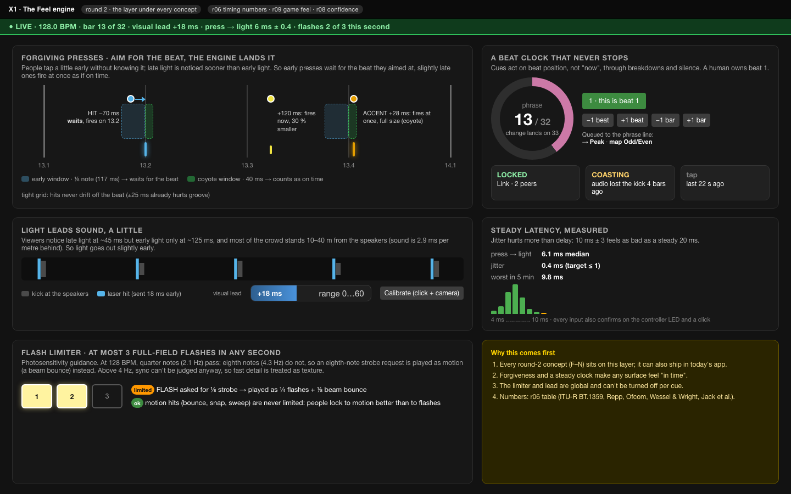
It covers forgiving presses, a beat clock that never stops, a "1" button, the visual lead, measured latency, and the flash limiter. **It can also ship inside today's app first.**

### One rig, three instruments
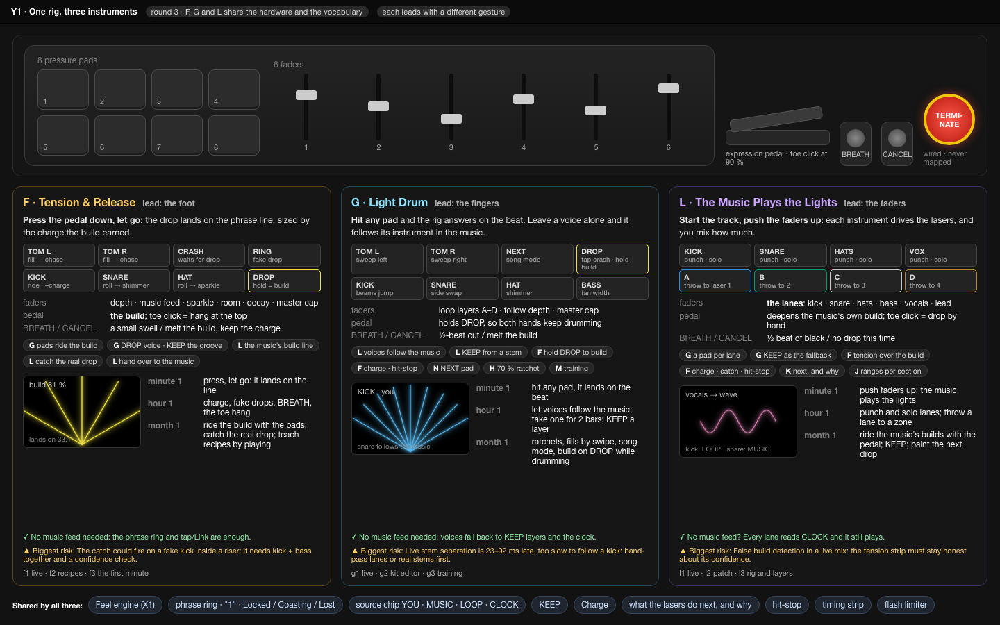

The rig: 8 pressure pads, 6 faders, an expression pedal with a toe click, BREATH and CANCEL footswitches, and a wired TERMINATE.

| | Instrument | Lead | Minute 1 | Borrowed | Size | Biggest risk |
|---|---|---|---|---|---|---|
| **F** | [Tension & Release](designs/F-tension-and-release.md) | **the foot** | press the pedal down, let go: the drop lands on the phrase line, sized by the charge the build earned | G: pads ride the build, the DROP voice, KEEP the groove. L: the music's build line, catching the real drop, handing over to the music | ≈ 5 wk without audio, 8–9 with | the catch firing on a fake kick inside a riser |
| **G** | [Light Drum & Loop Station](designs/G-light-drum.md) | **the fingers** | hit any pad and the rig answers on the beat; leave a voice alone and it follows its instrument in the music | L: following stems, KEEP from a stem. F: hold DROP to build, charge, hit-stop. N: song mode. H: the 70 % ratchet. M: training | ≈ 6–8 wk; ≈ 4 without stems | live stems are 23–92 ms late, too slow to follow a kick: band-pass lanes or real stems first |
| **L** | [The Music Plays the Lights](designs/L-music-plays-the-lights.md) | **the faders** | start the track, push the faders up: each instrument drives the lasers, and you mix how much | G: a pad per lane, throws, KEEP as fallback. F: a tension strip over the music's build, the drop catch. K, J, M, I: phrase data and "next, and why", ranges, the locked top 20 %, colour from the vibe | ≈ 9–11 wk (band-pass, with tension and pads) | false build detection in a live mix |

**What all three share:**
- the phrase ring, with "1" and Locked / Coasting / Lost;
- the source chip YOU · MUSIC · LOOP · CLOCK;
- **KEEP**;
- **Charge**, so the big drop is earned;
- "what the lasers do next, and why";
- hit-stop, the timing strip, and ranges per section.

**Each works with no music analysis.** Analysis only adds to it, and never starts anything by itself.

#### F · Tension & Release
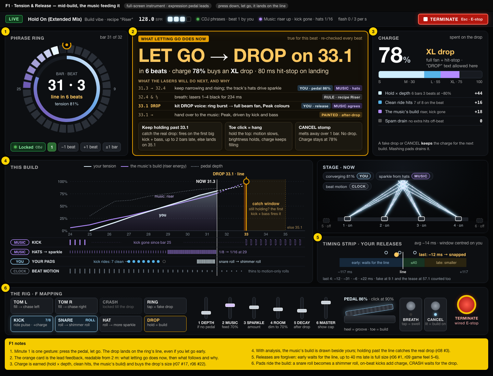
More: [F2 recipes, made easy](mockups/f2-tension-recipe.png) · [F3 the first minute, layers and training](mockups/f3-tension-first-minute.png)

#### G · Light Drum & Loop Station
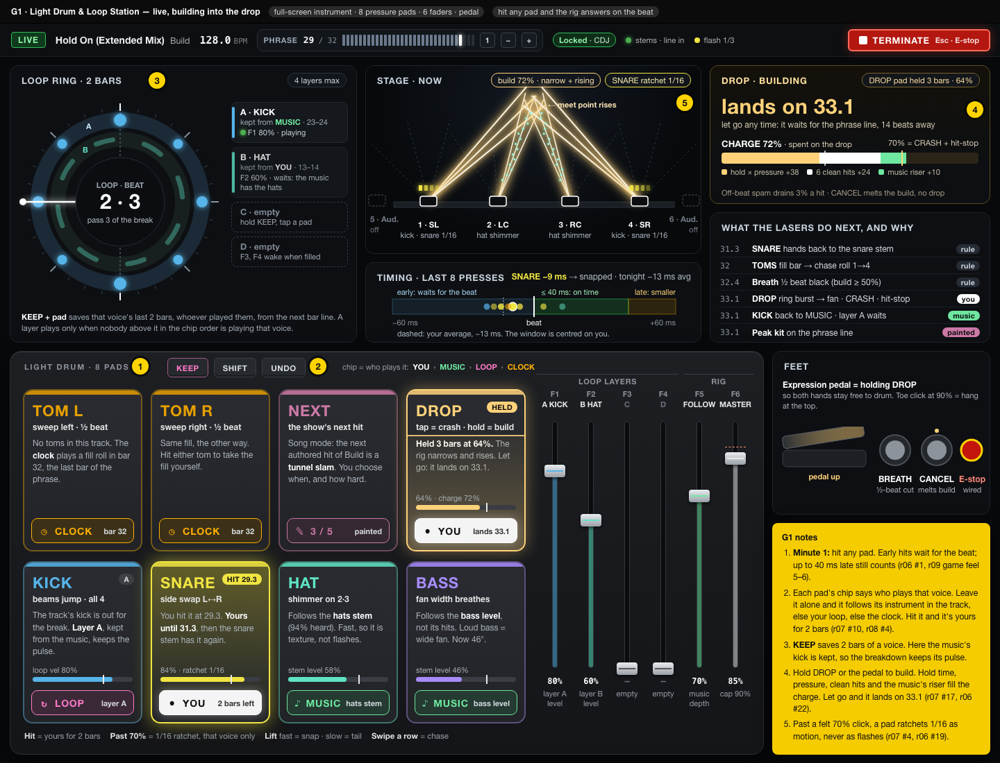
More: [G2 kit editor](mockups/g2-light-drum-kit-editor.png) · [G3 training](mockups/g3-light-drum-training.png)

#### L · The Music Plays the Lights
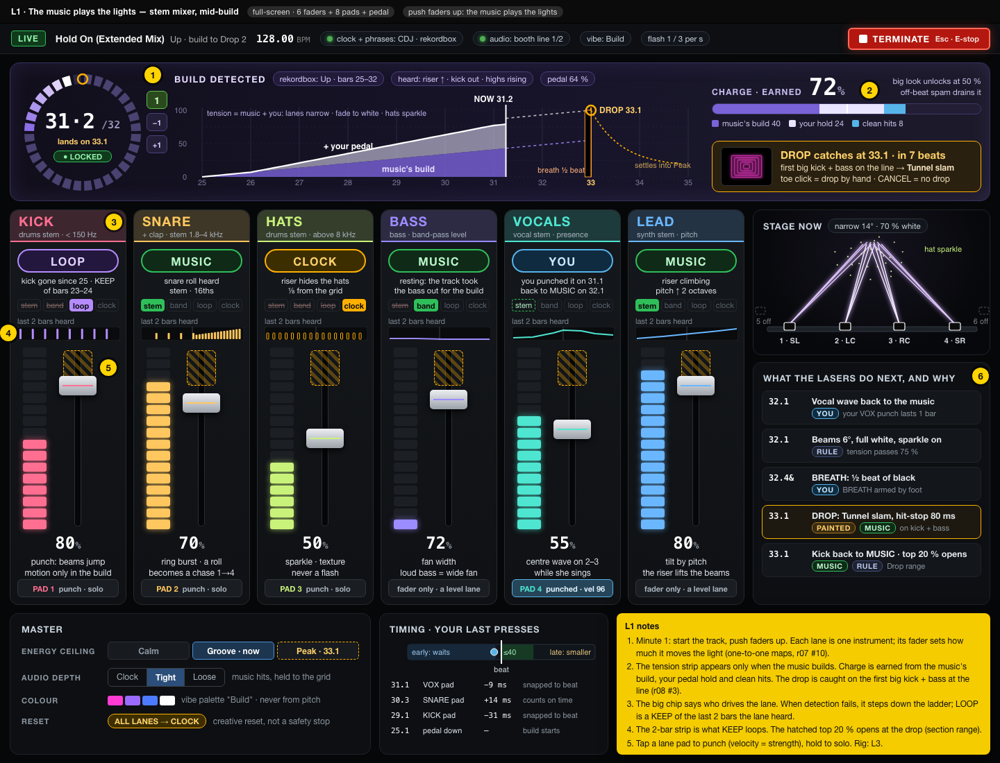
More: [L2 patch](mockups/l2-stems-patch.png) · [L3 the rig, and what reveals itself when](mockups/l3-rig-mapping.png)

### Suggested next step
1. **Build the Feel engine (X1)** inside today's app. All three instruments need it, and today's five pads benefit straight away.
2. **Prototype the three leads cheaply, in this order:**
   - **F** with a MIDI expression pedal, about 2 days.
   - **G** with an 8-pad controller, kick and snare only, about 2 days.
   - **L** with loopback audio and four band-pass lanes on a fader controller, about 3–4 days.

   Log every press and release against the beat clock. No field study of laser operators exists, so these logs are the evidence.
3. **Then decide** whether they stay three modes, or become one instrument where the faders are L's lanes, the pads are G's voices and the pedal is F's build. The shared rig and vocabulary already allow that.

### Questions for you
1. **One instrument or three modes?** Should F, G and L stay separate modes on the shared rig, or merge into one surface (faders = L, pads = G, pedal = F)?
2. **Is live audio input on the table?** It unlocks L, and "the music joins in" for F and G. But it brings latency, licensing (aubio is GPL, Essentia AGPL, the Demucs weights research-only) and setup at the gig.
3. **Do you play on Pioneer CDJs with rekordbox-analysed tracks?** Then phrase data for the ring and "next, and why" is available today, through Beat Link Trigger.
4. **Is the shared rig right for you?** That's a pad controller with faders, a pedal and two footswitches. Or should the first prototypes need only a laptop and a MIDI controller?

## 6. Files

| Path | What |
|---|---|
| `research/01-laser-and-lighting-software.md` | Pangolin BEYOND/QuickShow, Modulaser, LaserOS, Showeditor, grandMA3, ChamSys, Avolites, Lightkey, QLC+, SoundSwitch: 20 patterns |
| `research/02-vj-and-dj-software.md` | Resolume, VDMX, Synesthesia, Millumin, TouchDesigner/TouchOSC, rekordbox/Serato/Traktor, DJM FX, SoundSwitch: 20 patterns |
| `research/03-music-instruments-and-apps.md` | Ableton/Push, Launchpad, APC/MPC, Maschine, Circuit, Polyend, Elektron, Teenage Engineering, SP-404, Kaoss, Koala, Loopy, Bitwig: 20 patterns |
| `research/04-hci-principles-for-live-performance.md` | NIME mapping, cognitive load, glanceable and dark UI, safety-critical patterns, setup, field studies: 25 rules and a 15-question checklist |
| `research/05-rig-setup-and-spatial-mapping.md` | BEYOND zones, Resolume Advanced Output, MadMapper, grandMA3 layouts, Hue/Nanoleaf/Sonos setup, Dante/Q-SYS/d&b/L-Acoustics, laser safety UI: 19 patterns |
| `research/06-how-people-perceive-and-feel-music.md` | round 2: beat, groove, tension and release, emotion models, embodiment and cross-modal links, visual rhythm and flash limits, crowds; 25 ideas and a table of numbers |
| `research/07-expressive-instruments-and-new-interfaces.md` | round 2: MPE, grids and generative instruments, gesture and body, drums and looping, platters, rhythm games, colour organs and AV performers; 20 mechanics, 12 instrument principles |
| `research/08-music-aware-and-audio-reactive-shows.md` | round 2: beat, onset, energy, drop and stem analysis, audio-reactive tools, Link/MIDI clock/Pro DJ Link, failure modes; 15 ideas and a feasibility ladder |
| `research/09-unconventional-control-systems.md` | round 2: phones, feet, camera and body, wearables, crowds, HOTAS and broadcast, game feel, safety; 20 systems and 10 game-feel principles |
| `designs/10-round2-catalogue.md` | rounds 2–3: the Feel engine rules, the three instruments, the shared vocabulary, what each borrowed, safety |
| `designs/F-*.md`, `G-*.md`, `L-*.md` | round 3: one doc per instrument: the feeling, the music → light mapping, screens, learning curve, what it needs, a cheap prototype, how it fits, safety, risks, what changed, borrowed from |
| `designs/00-pain-points.md` | P1–P8, with evidence from today's screens |
| `designs/01-design-language.md` | the shared language |
| `designs/02-research-synthesis.md` | 14 findings that came up in three or more notes, and the warnings from user complaints |
| `designs/A-…E-*.md` | one doc per design: the idea, the pain-point table, screens, the press table, setup steps, sizes, decisions touched, risks, open questions |
| `mockups/*.html`, `*.png` | round 1: 16 mockups and the language sheet (`a1`–`e3`, `s1`); rounds 2–3: 9 mockups for F, G and L (`f1`–`f3`, `g1`–`g3`, `l1`–`l3`), the Feel engine (`x1`) and the family sheet (`y1`). `kit.css` and `kit.js` are the shared toolkit (the app's own theme colours) |
| `mockups/today/*.png` | the app today, captured headless at `979c6c8` |

**Re-render a mockup:** `sh mockups/render.sh a1-instrument-live.html` (headless Chrome; 1440 × 900, or 1440 × 1100 for `.page.tall`).

**Caveats:**
- The mockups are HTML, not JavaFX. They match the app's colours and sizes, not its exact controls.
- The research couldn't read Reddit pages (HTTP 403), so those points come from search snippets. A few products are marked "not verified" in their notes.
- No field study of laser operators was found (r04 §7).
- Effort figures are each design's own rough estimate.
