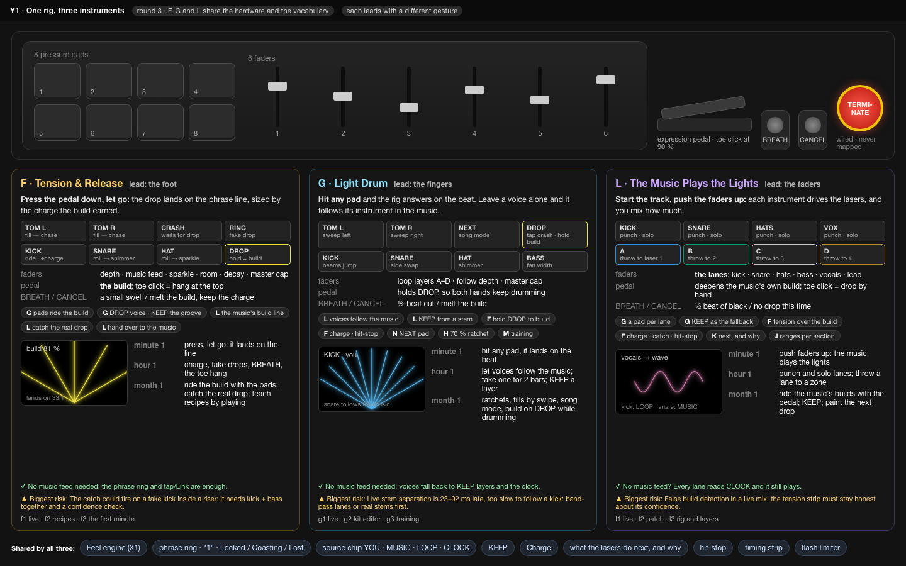

# Rounds 2 and 3: new ways to play light

**Written:** 2026-11-21. **Asked for:** "whole different UX systems… unique ways of triggering cues that fit better with how humans perceive and feel music… more similar to playing an instrument."

Round 2 drops the existing app's screens and starts from how music is felt. It has four new research notes:
- `r06`: how people perceive and feel music.
- `r07`: expressive instruments.
- `r08`: shows that understand the music.
- `r09`: unconventional controls and game feel.

Round 2 mocked up nine systems (F–N). On 2026-11-22 you kept three, **F, G and L**, and asked for better versions that "take the best parts from each other". The other six (H Colour Organ, I Mood Space, J Conductor, K Song Highway, M Flight Deck, N Beam Harp) were deleted, and their best mechanics were folded into the three (§4). Round 3 rewrote F, G and L in place, as one family.

## 1. One layer every idea needs: the Feel engine

Whatever the surface, these timing and safety rules make light feel musical. They belong under every concept, and they can be built first, inside today's app. Mockup: `../mockups/x1-feel-engine.png`.

| Rule | Why (research) |
|---|---|
| **The beat clock never stops**, even through breakdowns and silence. Every cue acts on *beat position*, not on "now" | people keep feeling the pulse without sound (r06 §1, Large) |
| **Forgiving presses**: a press up to ⅛ note early waits for the beat it aimed at. A press up to about 40 ms late fires at once, as if on time ("coyote time") | people tap early without knowing it; game designers quietly forgive (r06 #1, r09 game feel 5–6) |
| **Light leads sound by 10–30 ms** (a global "visual lead") | late light is noticed at about 45 ms, early light only at about 125 ms (r06, ITU-R BT.1359) |
| **Stay tight on the grid; the feel comes from which beats you hit** | shifting drums by about 25 ms already hurts groove (r06 §3) |
| **Motion hits by default, flashes as rare punctuation** | people lock to a moving beam better than to a flash (r06 #17) |
| **A hard flash limiter**: at most 3 full-field flashes in any second. At 128 BPM, quarter notes are fine and eighth notes are not | photosensitivity guidance (r06 #18) |
| **Fast subdivisions (above 4 Hz) are texture**, with no sync promise | people can't judge sync above about 4 Hz (r06 #19) |
| **Phrase awareness**: a ring for bar N of 8/16/32; "queue to phrase"; a "1" button and nudges | changes feel right on phrase lines; downbeat detection from audio is close to a coin flip, so a human sets beat 1 (r06 #8–9, r08 §1.1) |
| **Steady latency** of 10 ms or less, with jitter of 1 ms or less, measured and shown | jitter hurts more than delay (r07 §4, Jack et al.) |
| **Every input confirms on three channels**: the beam, the controller's light, and a click or buzz | "did that register?" should never be a question (r09 game feel 8) |

## 2. The three instruments: one family, three leads

| | Instrument | Lead gesture | Minute 1 | Mockups |
|---|---|---|---|---|
| **F** | [Tension & Release](F-tension-and-release.md) | **the foot**: shape the build→drop arc | press the pedal down, let go: the drop lands on the phrase line, sized by the charge the build earned | f1 live · f2 recipes · f3 the first minute |
| **G** | [Light Drum & Loop Station](G-light-drum.md) | **the fingers**: play every hit | hit any pad and the rig answers on the beat; leave a voice alone and it follows its instrument in the music | g1 live · g2 kit editor · g3 training |
| **L** | [The Music Plays the Lights](L-music-plays-the-lights.md) | **the faders**: the music plays, you mix | start the track, push the faders up: each instrument drives the lasers, and you mix how much | l1 live · l2 patch · l3 rig and layers |

**One rig** for all three: 8 pressure pads, 6 faders, an expression pedal with a toe click, two footswitches (BREATH, CANCEL) and a wired TERMINATE. Each instrument maps it differently (Y1).

**Each one works with no music analysis.** Tap or Link and the phrase ring are enough. When analysis is there, the music joins in: it follows, feeds builds and catches drops, and it never starts anything by itself.

## 3. The shared vocabulary

| Term | Meaning | Where it came from |
|---|---|---|
| **Phrase ring** | bar N of 8/16/32, with a "1" button, nudges and a **Locked / Coasting / Lost** chip | F, K, r08 |
| **Source chip** | who drives a lane or voice right now: **YOU · MUSIC · LOOP · CLOCK**, with fallback in that order | L, G |
| **KEEP** | capture the last 1–2 bars of anything (your hits, a stem's hits, your build curve) as a loop | G's loop ring, L's fallback |
| **Charge** | the big drop is earned: build time × depth, clean on-beat hits and the music's own build. It is spent on the drop; spam drains it | K's star power, M's DROP charge, r06 #22 |
| **What the lasers do next, and why** | upcoming changes, each tagged *you / music / rule / painted* | K, round 1's F5–F6 |
| **Hit-stop** | an 80 ms motion freeze on the biggest landings | M, r09 game feel 4 |
| **Timing strip** | your last presses or releases against the beat | G, M, X1 |
| **Ranges per section** | the show file sets how far you may push in each section, and the top 20 % opens on the drop | J, M |

## 4. What the three borrowed (from each other and from the dropped six)

| Part | From | Now in |
|---|---|---|
| Pads ride the build (rolls add sparkle, a snare roll becomes shimmer), the kit's DROP voice, KEEP the drop's groove | G | F |
| The music's build drawn beside yours, hats drive sparkle, catch the real drop on kick + bass, hand over to the music after it | L | F |
| Voices follow their instrument in the music; a hit takes the voice for 2 bars; KEEP from a stem | L | G |
| Hold DROP (or the pedal) to build, charge, CRASH with hit-stop | F | G |
| A pad per lane (tap = punch, hold = solo), zone throws, KEEP as the fallback before CLOCK | G | L |
| A tension strip over the music's own build, the pedal, BREATH, CANCEL, the drop catch | F | L |
| Phrase data from DJ gear, "next, and why", painting the next drop, a fill bar as a chase roll | K Song Highway | F, G, L |
| Training mode with an early/late histogram, the locked top 20 % | M Flight Deck | F, G, L |
| Two-stage press (a 70 % click → 1/16 ratchet), lift speed = snap or tail, velocity soft curve with a show cap | H Colour Organ | G |
| Ranges per section, hang time (hold the top) | J Conductor | F, L |
| Colour from the vibe's palette, never from pitch | I Mood Space | L |
| Song mode (a NEXT pad plays the next authored hit), a sweep across pads = a chase | N Beam Harp | G |

## 5. Safety that comes with these

- Gestures, the crowd and audio only ever pick from **pre-approved, pre-measured looks**. Higher-power audience scanning needs a trained operator with an emergency stop (r09 summary).
- **Haze blinds depth cameras.** Camera control must look at the desk, where the air is clear (r09 §3).
- **Clutches, never always-on gestures** (the "Midas touch" problem). Dead-man grips need a periodic re-press; in a 2003 train crash, a slumped driver's body kept the pedal pressed (r09 §7).
- **Wired or Wi-Fi beats Bluetooth** for anything critical. Bluetooth can take 10–30 s to reconnect and adds a fixed 7.5–11 ms on Apple devices (r09).
- **Audio-driven brightness and scan speed stay inside audience-scanning limits** (r08).
