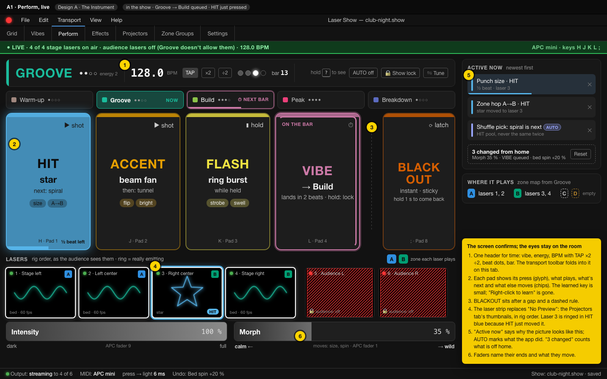
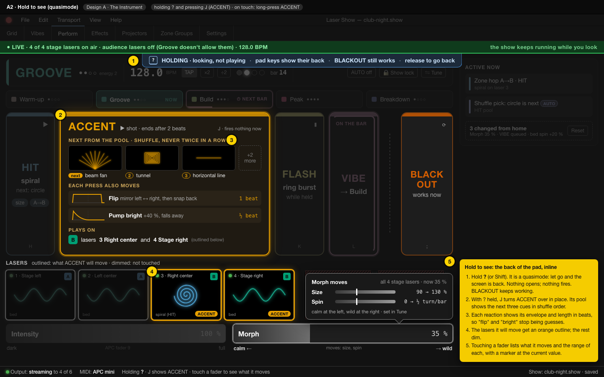
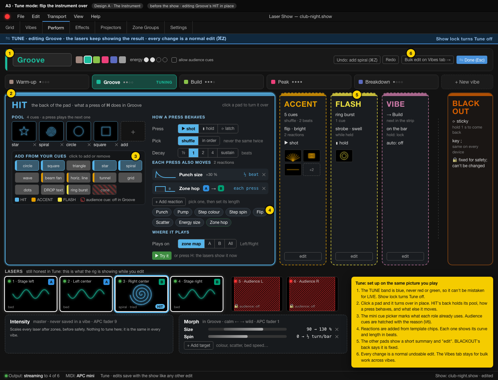
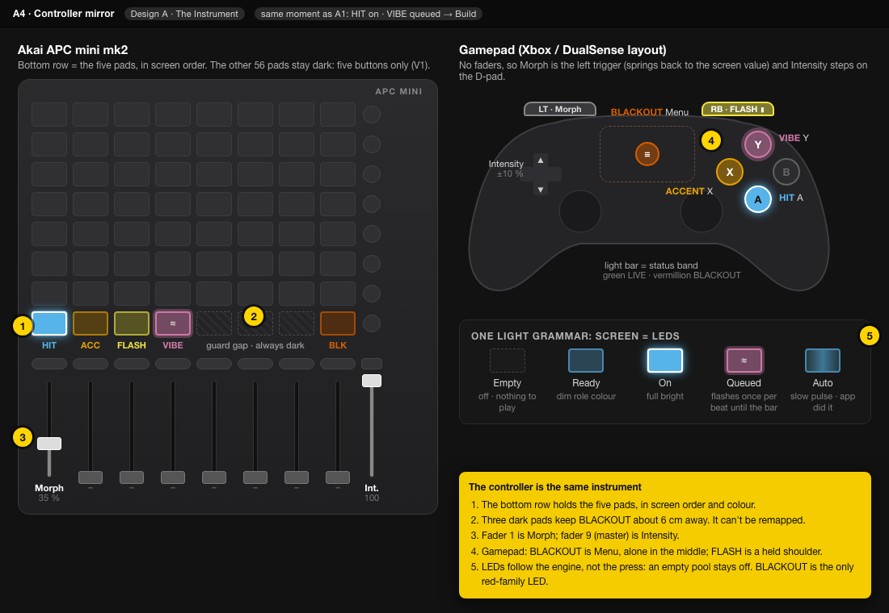

# A. The Instrument

**The Perform tab becomes a self-explaining instrument: five pads that say what they will do, a strip of the real lasers, and a back you can turn over.**

Inspired by: Launchpad / Push light grammar (r03 #1, r02 #16), declared press types (r02 #1, r03 #2), touch-reveals-target (r03 #18), Resolume's macro overlay (r02 #4), SoundSwitch "Active Looks" (r02 #14), CDJ on-air ring (r02 #8), the grandMA "non-default" count (r01 #15), and TouchDesigner's perform/edit split (r02 #19).

## The idea

This is the smallest step from today: the same five pads, two faders and vibe strip, with no new concept to learn. The performer looks at the room; the screen only confirms. A glance shows what the next press will do, which lasers it will move, and why the picture looks the way it does. The detail sits on the **back** of each pad. In the show, hold **?** to peek at it. Before the show, flip the instrument over (**Tune**) and edit it in place.

**Who it's best for:** a solo busker who already knows the app, and anyone who wants better live feedback with the least relearning.

## How it answers the pain points

| | How | Rating |
|---|---|---|
| **P1** Busking load | Each pad shows its glyph, what plays, what's next and what it moves. The live view has four concepts. | strong |
| **P2** Grouping setup | Tune edits pads in place, with a mini cue picker and template chips. Bulk work stays on the Vibes tab. | partial |
| **P3** Presses move effects | Chips; the reaction curves on the back; role-colour rings on the lasers a press moved; "Active now". | strong |
| **P4** Rig setup | Unchanged. The strip only reflects the rig order. | not addressed |
| **P5** Zone effects live | A zone letter on each tile, "Where it plays", and zone reactions as chips. Patterns are set up elsewhere. | partial |
| **P6** Screen tells the truth | Honest tiles replace "No Preview"; AUTO tags with reasons; the LEDs follow the engine. | strong |
| **P7** Too many concepts | Nothing new, but nothing removed. Pool, decay and reactions move to the back. | partial |
| **P8** Safety | BLACKOUT is guard-gapped on screen and on the hardware, can't be remapped and works in every mode. Show Lock disables Tune. | strong |

## Screens

- A green **LIVE** band (r01 #14). The transport toolbar folds into the **vibe header**: name, energy, BPM with TAP ×2 ÷2 (r01 #17), beat dots and the bar (r02 #20).
- **Pads** use the shared states: HIT on with a decay bar, ACCENT and FLASH ready, VIBE queued with a ring filling to the bar (r03 #4). Each shows its glyph (r02 #1, r03 #2), what plays, what's next and reaction chips (r04 rule 13). The key is small at the bottom.
- **BLACKOUT** sits after a gap and a dashed rule (r04 rule 4): "instant · sticky · hold 1 s to come back" (r04 rule 10).
- The **laser strip** is in rig order (r04 rule 18). Laser 3 has a HIT-blue ring because HIT just moved it (r03 #13). The audience lasers are hatched (r05 #13).
- **Active now**, newest first, with an AUTO row (r02 #14, r04 rule 14), and **3 changed from home · Reset** (r01 #15, r03 #11).
- The **faders** name their ends and what they move (r03 #8).

- Holding **?** is a quasimode (r04 rule 7): "looking, not playing · release to go back". The rest dims; the show runs on.
- **J** turns ACCENT over **in place**, not in a dialog (r04 rule 1). It shows the next three pool cues in shuffle order (r02 #7), each reaction's curve and length in beats (r02 #3, r01 #5), and where it plays.
- The lasers ACCENT will move get an orange outline; the rest dim (r03 #18).
- Touching **Morph** lists its targets with ranges and a marker at the current value (r02 #4). BLACKOUT still works.

- A blue **TUNE** band replaces LIVE. Show Lock turns Tune off (r03 #15).
- HIT's back: pool cells (✕ / +), a **mini cue picker** with role stripes and hatched audience cues (V6), and press type, pick, decay and where it plays. Reactions are listed with curves, plus "+ Add reaction" and template chips.
- The other pads show **compact backs** with "edit". BLACKOUT's back says it is fixed.
- **Undo / Redo** sit in the header. Edits are normal undoable edits, with no confirm boxes (r04 rule 21). **▶ Try it** shows the result on the honest laser strip.

- **APC mini mk2**: the bottom row holds the five pads. Pads 5–7 are a dark guard gap, and BLACKOUT is pad 8. Fader 1 is Morph and fader 9 is Intensity. The other pads stay dark (V1).
- **Gamepad**: A HIT, X ACCENT, RB (hold) FLASH, Y VIBE, Menu BLACKOUT. LT is Morph (it springs back). The D-pad steps Intensity.
- **One light grammar** on the LEDs (r03 #1, r04 rule 6). The LEDs follow the engine, not the press (r02 #17).

## Interaction details

| Control | Press | Hold | Release |
|---|---|---|---|
| **HIT** ▶ | plays the pool's next cue now (not quantised), plus its reactions (Punch size ½ beat, Zone hop A→B) | same; a shot ends after its decay. If its press type is ▮, it stays on while held | nothing for a shot; for ▮, the look returns |
| **ACCENT** ▶ | plays the next accent cue, plus Flip (1 beat) and Pump (½ beat) | same as press | nothing |
| **FLASH** ▮ | ring burst on, plus Strobe and Swell | stays on while held | the look comes back (the bed kept running underneath, r02 #10) |
| **VIBE** ⏱ | queues the next vibe in the strip; it lands on the bar. A second tap while queued cancels it | ≥ 0.6 s = lock this vibe (auto-advance off) | nothing |
| **BLACKOUT** ⟳ | instant dark, latched. A second tap does nothing | when dark, holding ≥ 1 s brings the light back | nothing |
| **Intensity** | master level, after zones and before safety | – | – |
| **Morph** | calm ↔ wild across the vibe's targets (size, spin), with light smoothing (r01 #19) | touching it shows its overlay | the value stays put (on a gamepad trigger it springs back) |

**Quasimodes and modes**
- **Hold ? / Shift** (or the APC's Shift): pad keys show their backs and fire nothing; touching a fader shows its overlay. BLACKOUT and the faders still work. Releasing restores the screen.
- **Touch**: hold the on-screen **?** and tap a pad. Long-press works only on HIT and ACCENT, *after* the shot fires, because FLASH and VIBE already use hold.
- **Tune** is a real mode, so it has two indicators (r04 rule 8): the blue band and the flipped pads. Show Lock turns it off; Esc leaves it.

**Tune and the Vibes tab.** Both edit the same vibe data. HIT's back is the Vibes tab's HIT sub-tab (pool picker, Play, Beats, Order, Tap reactions), laid out in the pad's shape. ACCENT and FLASH work the same way. VIBE's back holds the order and auto-advance. The Vibes tab stays for bulk work: creating and duplicating vibes, BED, FX set, FLASH effects and the checklist.

**"Active now" rules**
1. One row for each thing that moves the picture away from the vibe's resting look: a running reaction (with time left), a held FLASH, a zone hop or override, or an AUTO change (pool pick, beat chase, auto-advance) with a reason.
2. Newest on top, at most four rows; older ones fold into "+N more".
3. Shots leave when their decay ends; latched rows stay until released. A row's ✕ cancels it (mouse only).
4. The stripe is the role colour; AUTO rows get the auto colour and tag.
5. "**N changed from home**" counts states that last: faders away from the stored values, latches, overrides, a queued vibe. **Reset** returns them all except Intensity and BLACKOUT, as one undoable step.

**Laser strip.** It reuses the per-projector snapshot thumbnails that the Projectors tab already draws, in rig order, throttled to about 20 fps. They come from the frame already sent, so there is no extra render (zones invariant 8). Each tile has a white on-air ring after Intensity, blackout, zones and safety (r04 rule 16), and a zone letter. For one beat after a press moves a laser, its tile gets a ring in the role colour. A dark tile shows amber dashes and a reason; an audience laser stays hatched until it is allowed.

**Setup steps**
1. Projectors: Scan, then drag the lasers into order (as today).
2. Vibes: "One per grid row", or New vibe ×5 (as today).
3. Perform → **Tune**: turn each pad over, add cues from the mini picker, and tap a reaction chip.
4. On each back, click the key field and press the controller button, or pick the APC mini / Launchpad Mini template.
5. **Done**, then Show Lock. The band reads LIVE.

Time to first show: about **8 min** for two vibes on a known rig, or **15 min** for five vibes.

## What it reuses and what is new

**Reuses:** the Perform tab (pads, faders, vibe strip, AUTO, Show Lock, NO OUTPUT, the watchdog); the vibe model and the Vibes tab's pool, decay, shuffle and reaction editors; the Projectors tab's thumbnails and rig order; zone maps; MIDI learn; undo.

| New | Size |
|---|---|
| Pad faces (glyph, next, chips, key, five states) | M |
| Engine exposes the next pick in a shuffled pool | S |
| Vibe header with TAP ×2 ÷2, beat dots and bar | S |
| Laser strip with on-air and "moved by" rings | M |
| Active now stack and "N changed · Reset" | M |
| Hold-to-see quasimode (pad back inline, fader overlay) | M |
| Tune mode (flip, the HIT back, compact backs) | L |
| Controller LED feedback and templates (APC mini, Launchpad Mini, gamepad) | M |
| BLACKOUT guard gap, non-remappable, hold 1 s to leave | S |

**Total:** 3 S + 5 M + 1 L ≈ 5 + 20 + 8 days ≈ **6–7 weeks** for one developer.

## Decisions it touches

- **V1** (five buttons, two faders): kept; the controller leaves its other pads dark.
- **V2** (sticky blackout): kept. It adds "hold 1 s to come back" (r04 rule 10), which is a refinement, not a change.
- **V5** (Intensity + Morph): kept. Morph gets named ends and a target list.
- **V6 / V10** (the audience rule): kept. The picker hatches audience cues, and the tiles hatch audience lasers.
- **V8 B** (vibe things on their own tabs): kept, because nothing reaches the Grid tab. But Tune adds a **second place** to edit a vibe, on Perform, on purpose.
- **Zones**: maps, patterns and the one-render-per-cue invariant are unchanged. The tiles only display the zone letters.

## Risks and trade-offs

- **Two editors for one vibe** (Tune and the Vibes tab) can drift apart. They must share components.
- **Dense pads.** At 2 m, the text may crowd. Cap the chips at three.
- **Hold-to-see takes a free hand**, which is awkward on touch or a gamepad.
- **Tune during a show** shows the edits to the audience unless Show Lock is on. "Silent edit" (r02 #19) is left for later.
- **It doesn't cut the concept count** (P7) or fix rig setup (P4).

## Open questions

1. Should "next: spiral" be a promise? The engine must commit to the next shuffle pick, and an edit in Tune would re-roll it.
2. Should Tune be blocked while the band is LIVE with an audience, or only when Show Lock is on?
3. Is long-press on HIT or ACCENT (after firing) worth offering on touch, or is the on-screen ? enough?
4. Which controller templates should ship first, and how should an RGB-less APC mini mk1 show "queued" against "auto"?
5. Should Active now rows be cancellable from the controller (for example ? + pad), or only with a mouse?
