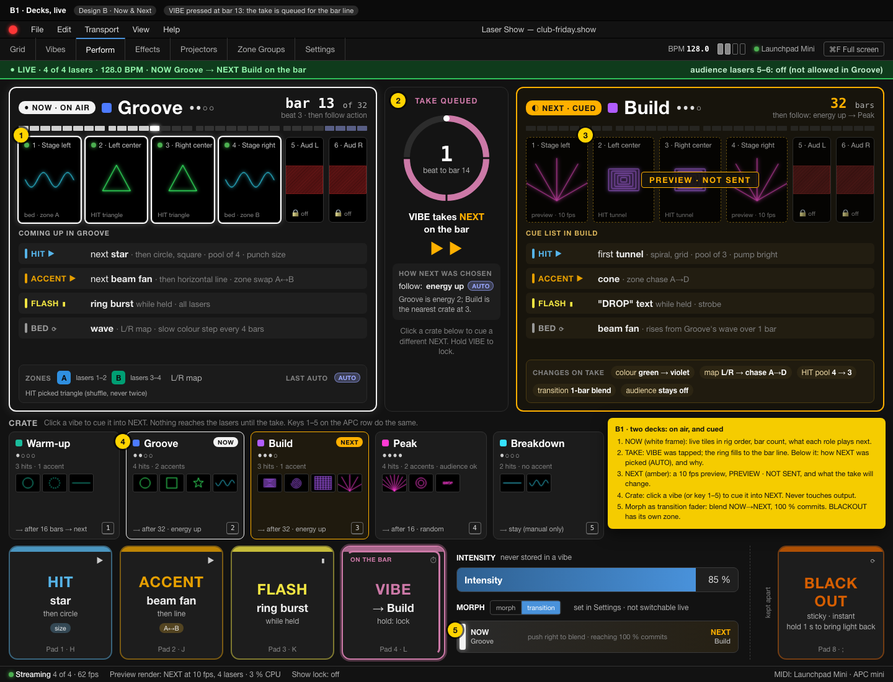
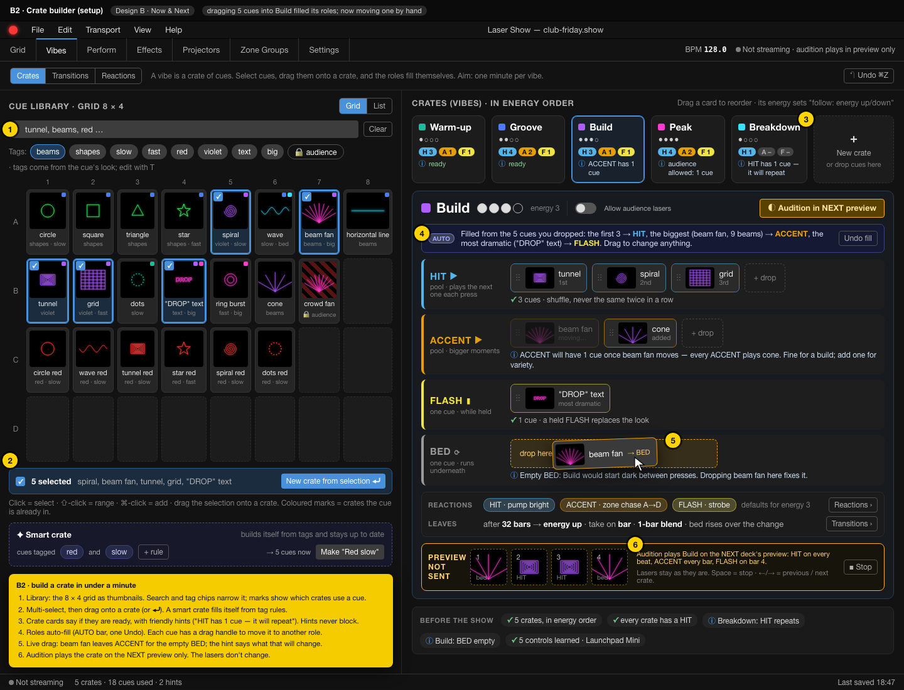
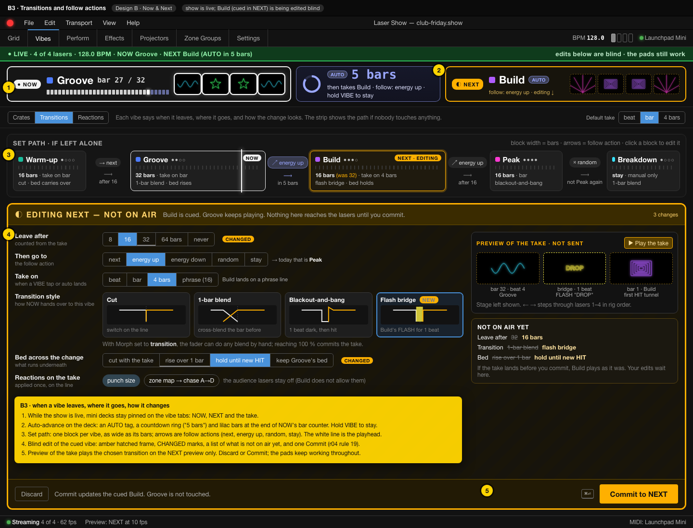

# B. Now & Next

**Two decks: NOW is on air, NEXT is cued and previewed. You see the next vibe before the room does, and one tap of VIBE takes it on the bar.**

Inspired by: the DJ headphone cue and Resolume's preview (r02 #7), Autopilot and Autoloops (r02 #12), Silent Edition and Eos Blind (r02 #19, r04 rule 19), DJ crates (r04 §7, rule 24), scene queueing (r03 #1, #4), the Octatrack crossfader (r03 #8).

## The idea
A vibe is a **crate**. Perform has two decks. **NOW** (white frame) shows real per-laser tiles, a bar counter and what each role plays next. **NEXT** (amber frame) shows the cued vibe as a low-rate preview, marked PREVIEW · NOT SENT, with what the take will change. NEXT is filled by the vibe's follow action ("energy up") or by you, calmly, from the crate strip. Live, VIBE does one thing: take NEXT on the bar.

**Who it's best for:** DJs and VJs who think in decks and cue/preview. Also sets that move through energy levels, where the app proposes and the performer decides.

## How it answers the pain points

| | How | Rating |
|---|---|---|
| **P1** Busking load | The next decision is made early and shown, with its reason. VIBE only means "take". Role rows say what each press plays next | strong |
| **P2** Easy grouping | Crate builder: select, drop, roles fill themselves, one Undo. Hints, Audition, smart crates. About 1 min per vibe | strong |
| **P3** Presses move effects | Reaction chips on pads and rows. "Changes on take" lists what the take moves | partial |
| **P4** Rig setup | Not changed. It reuses the rig-order tiles | not addressed |
| **P5** Zone effects | Zone chips on NOW. Zone-map changes appear in NEXT's diff before they land | partial |
| **P6** Truth | NOW tiles show what is really sent. NEXT has dashes, a PREVIEW band and no ring. Every AUTO pick says why (r04 rule 14) | strong |
| **P7** Concepts | Pools and beds hide in deck rows, but it adds NEXT, take, follow and transition | partial |
| **P8** Safety | BLACKOUT has its own zone. Audience stays hatched in the preview. A blend falls back to a cut if overloaded | partial |

## Screens

- **NOW**: Groove, "bar 13 of 32". The last four bars are lilac (the follow action will fire there). Tiles are in rig order, with audience lasers 5–6 hatched. Role rows ("next star · then circle, square"). A footer shows the zones and the last AUTO pick.
- **TAKE**: VIBE was tapped, and the ring fills to bar 14. Underneath it explains "follow: energy up · AUTO" and why.
- **NEXT**: Build, with dashed 10 fps tiles behind PREVIEW · NOT SENT. "Changes on take" lists colour, zone map, pool size, transition and audience.
- **Crate strip**: five cards with energy and follow action. Click one, or press key 1–5, to cue it into NEXT. Output is never touched.
- **Controls**: the S1 pads. VIBE reads "→ Build · on the bar". Morph is in *transition* mode (NOW ↔ NEXT). BLACKOUT sits behind a divider (r04 rule 4).

- **Library**: the 8 × 4 grid as thumbnails, with search, tags (beams, slow, red, 🔒 audience) and marks for the crates that already use a cue.
- **Multi-select**, then drag onto a card or press ⏎ "New crate from selection" (r03 #17).
- **Auto-fill** (shown with an AUTO bar): the first cues go to HIT, the biggest to ACCENT, the most dramatic to FLASH. One "Undo fill".
- **Role lanes** with ⋮⋮ handles. The mockup shows *beam fan* being dragged from ACCENT to the empty BED.
- **Hints, not errors**: "HIT has 1 cue — it will repeat". They are neutral blue and never block (r04 rule 20).
- **Audition** plays the crate on NEXT's preview only. A **smart crate** fills itself from tag rules ("red and slow").

- **Pinned mini decks** while live. Auto-advance shows as AUTO, a "5 bars" countdown ring and "hold VIBE to stay" (r02 #12, #13).
- **Set path**: blocks as wide as their bars. Arrows are the follow actions. A white playhead marks the position.
- **Blind edit** of the cued vibe: an amber hatched frame, "EDITING NEXT — NOT ON AIR", CHANGED marks and a "Not on air yet" diff. One **Commit to NEXT**, plus Discard (r04 rule 19).
- **Per-vibe settings**:
  - leave after N bars or never;
  - next, energy up or down, random, or stay;
  - take on beat, bar, 4 bars or phrase;
  - cut, 1-bar blend, blackout-and-bang or flash bridge;
  - what the bed does across the change.
- **Preview of the take**: the last beat, the bridge and the first HIT, on the preview only. If the take lands before you commit, the old Build plays and your edits wait.

## Interaction details

| Control | Press | Hold | Notes |
|---|---|---|---|
| **HIT / ACCENT** | the next cue from NOW's pool (▶) | as today | NEXT's pools never play from a pad |
| **FLASH** | — | NOW's FLASH while held (▮) | — |
| **VIBE** | **take NEXT** on the quantum (⏱). A second tap cancels | held ≥ 0.6 s alone: **lock** toggle. No auto picks, no auto-take. The pad and TAKE both show LOCKED (r04 rule 8) | **Quasimode**: while VIBE is held, HIT = previous crate and ACCENT = next crate into NEXT. The labels swap while it is held (r03 #5, r04 rule 7) |
| **BLACKOUT** | instant, sticky (⟳) | hold 1 s to bring light back | unchanged and isolated |
| **Intensity** | master | — | unchanged |
| **Morph: *morph*** | today's macro | — | unchanged (V5) |
| **Morph: *transition*** | blends NOW → NEXT. Pulling back aborts. **Reaching the end commits** | — | The ends then swap, like a DJ crossfader, so the fader never jumps. A blend parked mid-way shows amber "2 renders" |

**Choosing NEXT with no extra buttons:**
1. The follow action fills it (AUTO, plus a reason).
2. A click on a crate card.
3. The VIBE quasimode.
4. Optionally, a second-hand key row (off by default).

Only VIBE, or an unlocked AUTO take, sends NEXT to the lasers.

**Setup**
1. Make cues on the Grid tab (as today).
2. In Vibes › Crates, select 4–6 cues and press ⏎. Name the crate and set its energy, then audition it (≈ 1 min).
3. Repeat for each vibe, then drag the cards into energy order.
4. In Vibes › Transitions, keep the defaults (32 bars, energy up, bar, 1-bar blend) or tweak them.
5. Learn the controls. In Settings, pick Morph = morph or transition.
6. On Perform, put a crate in NOW and press VIBE.

**Time to first show:** about 8–10 min for five vibes.

## What it reuses and what is new
**Reuses:** the vibe model (pools, FLASH, BED, FX set, reactions), VIBE tap/hold, auto-advance, show lock, NO OUTPUT, the watchdog, rig order and honest tiles, the audience rule, zone maps, and the Vibes checklist (which becomes the hints).

| New | Size |
|---|---|
| Perform decks: NOW / TAKE / NEXT, role rows, crate strip | M (4 d) |
| NEXT preview render (low-rate, not sent, shared cache) | M (4 d) |
| Cued-vibe state: take, cancel, lock, quasimode browse | S (2 d) |
| Follow actions per vibe | S (2 d) |
| Transition styles and bed behaviour | M (5 d) |
| Morph *transition* mode | S (2 d) |
| Crate builder: library, multi-select, drag, auto-fill, role lanes | L (8 d) |
| Cue tags, search, smart crates | M (3 d) |
| Audition on the preview | S (1.5 d) |
| Inline hints | S (1 d) |
| Blind edit: diff, Commit, Discard | M (4 d) |
| Set path strip and pinned mini decks | M (4 d) |
| Optional crate key row | S (1 d) |

**Total ≈ 41.5 days (8–9 weeks).** A first cut (decks, preview, follow actions, cut and blend, no builder) takes about 3 weeks.

### The cost of rendering NEXT
Zones invariant 8 is *one render per cue per tick*. A live NEXT preview needs a **second render** of the cued cues, so it breaks that rule. The limits:
- **Low rate, preview only.** It runs at 10 fps (every 6th tick), only for NEXT's HIT head and its BED, with a thumbnail point budget. It is never written to a driver.
- **Shared frames.** A cue that is in both decks (often the bed) reuses NOW's frame for that tick, so the rule still holds per cue.
- **Drop first.** Under load, NEXT freezes to stills and shows "preview paused · heavy". Output never waits for the preview.
- **Setting:** NEXT preview can be live, stills or off.
- **Blends are the real exception.** A 1-bar blend, or a parked Morph blend, sends two vibes to the lasers at full rate. That only lasts for the blend window. If it goes over budget, it snaps to a cut and shows an amber notice.

## Decisions it touches
- **V1** (five buttons): **kept.** Browsing is a VIBE quasimode, and the key row is optional.
- **V2** (sticky blackout): **kept**, and isolated.
- **V5** (Intensity + Morph): **kept as two faders.** *Transition* mode drops the Morph macro **on purpose**, for the whole show. It is set in Settings, never live.
- **V6 / V10** (audience): **kept.** The preview stays hatched, and the diff warns if the take would allow audience lasers.
- **V8 B** (own tabs): **kept.** Vibes gets Crates, Transitions and Reactions views.
- **Zones invariant 8**: **bent** for the preview and for blends, with the limits above. Nothing else is touched.

## Risks and trade-offs
- **A fifth concept live.** NEXT joins vibe, roles, zones and intensity (r04 rule 25). NEXT can collapse to its name and its diff.
- **Preview cost.** It needs measuring on big rigs, even with the limits.
- **AUTO can feel like the app is DJing** (r02 §4 "automation only"). That is why every pick has a reason, lock is one hold, and "stay" exists.
- **Transition mode's swapping ends** suit DJs but may confuse others. It is off by default.
- **Blind edits that miss the take** are kept, not lost, but the performer may expect them to be live. The diff stays visible until Commit.

## Open questions
1. When you tap VIBE, does the incoming vibe's "take on" value apply, or the outgoing one?
2. Is 10 fps enough to judge a fast cue? Should hovering give a full-rate peek?
3. Should "random" skip vibes more than one energy step away?
4. Should editing NOW live always fork into a blind copy that becomes NEXT?
5. On a 13" laptop, should the crate strip and the TAKE column fold into the deck headers?
