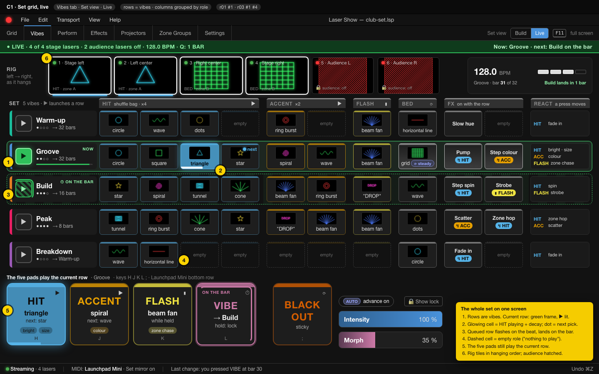
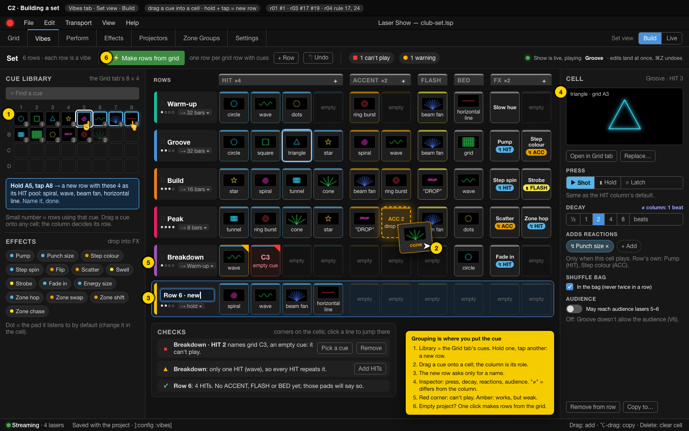
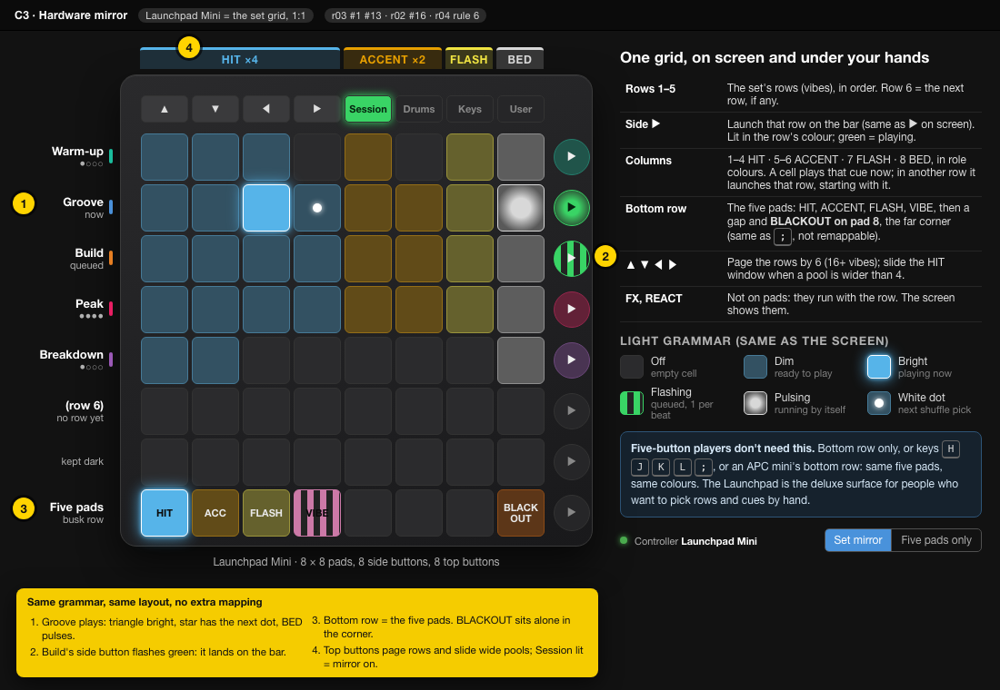

# C. Set Grid

**The whole set is one grid. Each row is a vibe, and each column belongs to a role. You group a cue by putting it in a column.**

Inspired by: Ableton Session View scenes and follow actions (r03 #4, r03 §2 Ableton), Pangolin BEYOND's coloured cue groups (r01 #1), Launchpad and Push light states (r03 #1), Circuit's hold-and-tap range chaining (r03 #17), and settings inherited from the column (r03 #19).

## The idea
Today a vibe sits behind six sub-tabs. The Set Grid makes every vibe one row of a table whose columns are grouped by role, in the role's colour: HIT ×4, ACCENT ×2, FLASH, BED, FX ×2 and a REACT readout. You build a vibe by dragging cues into its row. The same five pads always play the **current row**. What is playing, what plays next, what is queued and what is empty are all visible, with no menus (P2, P7).

**Who it's best for:** performers who plan a set as a sequence of moods (warm-up → peak → breakdown) and want to see it whole, plus Launchpad owners. Players who only use five buttons lose nothing.

## How it answers the pain points

| | How | Rating |
|---|---|---|
| P1 Busking load | The five pads don't change. The grid shows the next pick and the queued row. The cost is a denser screen than Perform. | partial |
| P2 Easy grouping | A cue's column is its role. Drag it in, or hold one cue and tap another for a new row. "Make rows from grid" is a one-click start. | strong |
| P3 What reacts to what | Each FX cell has a listen tag (↯ HIT, ▮ FLASH). The REACT column says in words what each press moves, and pad chips repeat it (r04 rule 13). | partial |
| P4 Rig setup | It only shows the honest rig strip. Setup is unchanged. | not addressed |
| P5 Zone effects live | Zone hop, swap, shift and chase are ordinary FX cells in a row, and their listen tag says which press drives them. Maps and step grids stay on the Effects tab. | partial |
| P6 Truth | Playing, queued, next, empty and running-by-itself states use one grammar on screen and on the LEDs. Rig tiles stay honest. Lint corners mark cells that can't play. | strong |
| P7 Too many concepts | Pool, slot, FX set, flash effects and role editor all fold into one idea: rows × columns. The only new word is "set". | strong |
| P8 Safety | BLACKOUT sits alone at the end of the pad row and in the Launchpad's corner. Each cell has an audience flag under the row's rule (V6). Show lock and the watchdog are kept. | partial |

## Screens

- **Where it lives.** It is the Vibes tab's **Set view**, with a **Build | Live** switch, and F11 makes it full screen. That keeps it off the Grid tab (V8 B). It replaces today's vibe list and editor, so the grid you build is the grid you play. Perform stays as the big five-pad screen.
- **Rows are vibes.** Each row has a ▶ launch button, energy dots, a follow hint ("→ 32 bars") and the vibe's colour. The colour is on the row head only, so it never competes with role colours. The current row has a green frame, a lit ▶ and a bar-progress line.
- **Live state.** The playing HIT (triangle) glows with a decay bar, and a dot marks the next shuffle pick (star). The BED shows "⟳ steady". Build is queued: its ▶ flashes and is marked "on the bar".
- **Dashed cells are empty slots.** When all of a role's cells in a row are empty (Breakdown's ACCENT and FLASH), that pad goes to its Empty state and says "nothing to play" (r04 rule 17).
- **The five pads, compact,** play the current row. BLACKOUT is set apart. Faders, AUTO and Show lock are unchanged.
- **Rig strip** in hanging order: a white ring means emitting, a HIT-blue underline marks lasers the last HIT moved, and the audience lasers are hatched.

- **The cue library drawer** shows the Grid tab's own 8 × 4, with how many rows use each cue. Effect templates sit below it.
- **Drag to place.** Cone is dropping into Peak's ACCENT 2 cell. The column decides the role.
- **Range select (r03 #17).** Hold A5 and tap A8, and **Row 6 · new** appears with those four cues as HITs and its name field focused.
- **Cell inspector:** press type (▶ / ▮ / ⟳), decay in beats, the reactions this cell adds, the shuffle bag and the audience flag. "≠ column" marks a value that differs from the column default (r03 #19).
- **Lint corners.** Red means it can't play (C3 is an empty cue). Amber means it is weak (only one HIT, so it repeats). Checks lists them.
- **Make rows from grid** (the existing `make-from-rows`) comes first in the toolbar. Edits land at once and ⌘Z undoes them (r04 rule 21).

- The Launchpad Mini mirrors the grid 1:1. Rows 1–5 are the vibes. Columns 1–4 are HIT, 5–6 ACCENT, 7 FLASH and 8 BED, all in role colours. Side buttons launch rows on the bar.
- **The bottom row holds the five pads**: HIT, ACCENT, FLASH and VIBE, then a gap, then BLACKOUT on pad 8 in the far corner. Row 7 stays dark as a buffer.
- **The light grammar matches the screen:** off = empty, dim = ready, bright = playing, flashing = queued (the Launchpad's native flash, one per beat), pulsing = running by itself, white dot = next pick.
- ▲ ▼ page the rows by six, and ◀ ▶ slide wide pools. FX and REACT don't get pads.
- Five-button players can ignore all of this. "Five pads only" lights just the bottom row.

## Interaction details

| Control | Press | Hold | Release |
|---|---|---|---|
| HIT | Next cue from the current row's HIT cells (shuffle bag); the next dot moves | ▮ cells stay on | ▶ decays by itself |
| ACCENT | Same, from the ACCENT cells | as HIT | as HIT |
| FLASH | — | FLASH cell + FX cells tagged ▮ FLASH | back to the row |
| VIBE | Queues the **row below** on the bar (wraps) | Lock: the row stops following, 🔒 on its head | — |
| BLACKOUT | Sticky dark, immediate | — | Leaving uses the existing other gesture (V2) |
| Intensity / Morph | Unchanged (V5) | | |
| Row ▶ / side button | Queues that row on the bar | Quasimode: **Shift+▶** launches now | — |
| Cell click (Live) | Current row: plays that cue now. Other row: queues that row, starting with it | — | — |

No live control opens anything. Build-only actions (drag, inspector, rename) are off while Live is on or the show is locked.

**Setup steps**
1. Make or import cues on the Grid tab, as today.
2. Open Vibes → Set → Build and click **Make rows from grid** (one row per grid row). Or hold one cue and tap another for each mood.
3. Drag extra cues into the ACCENT, FLASH and BED cells. Drop effect templates into FX.
4. Name the rows and set energy and follow ("→ 32 bars").
5. Fix any red corners. Switch to Live.

**Time to first show:** about 1 minute for one playable row (r04 rule 24), and about 5 minutes for a five-row set like the one in the mockups.

## What it reuses and what is new

**It reuses** `[:config :vibes]` one to one, so this is mostly a new view:

| Grid | Data |
|---|---|
| row, row head | a vibe in `:order`; `:name :color :energy` |
| HIT / ACCENT cells | `[:hit :cells]` / `[:accent :cells]`, in pool order. A dashed slot is just a shorter pool; nothing is stored |
| FLASH, BED | `[:flash :cue]`, `:bed` |
| FX cells | `:fx`; cells tagged ▮ FLASH are `[:flash :fx]` |
| REACT | worked out by `reactions/listens-to` (shown in Live, not in Build) |
| column defaults | each role's `:mode :beats :select` |

It also reuses the shuffle bags, `vibe-runtime`, auto-advance, the lint (`library/unplayable`), `make-from-rows`, `cell-index`, the audience rules, the watchdog and show lock.

**New:**
- Set view, read-only: rows × role groups, live states from `vibe-runtime`, compact pads, rig strip. **M**
- Next-pick peek on shuffle bags, and the queued-row state. **S**
- Row launch on the bar, Shift = now, cell click to play or queue. **S**
- Per-row follow in bars (`:follow {:bars 32 :to :next}`), next to today's seconds-based rotation. **S**
- Build mode: library drawer, drag into a slot (insert or replace in the pool), drag between rows, ⌥-copy. **M**
- Range select → new row with a name field. **S**
- Cell inspector. Column defaults first (**S**), then per-cell overrides for press, decay and added reactions, which need engine support (**M**).
- Lint corners and Checks list over the existing lint. **S**
- Launchpad Mini / APC mini mirror: programmer mode, LED states, paging, bottom-row pads. **M**
- Many rows: a compact row height, a pinned current row and auto-scroll. **S**

**Total:** 4 M (about 16 d) + 7 S (about 10 d), so about 5 weeks.

**Limits.** HIT up to 8 columns, ACCENT 4, FLASH 1, BED 1, FX 4; more shows a "+3" chip. Live fits seven full rows on a laptop. **With 16+ vibes**, rows drop thumbnails (44 px), the grid scrolls with the current and queued rows pinned, and the Launchpad pages by six. **A wide pool** widens only its own group; other rows show dashed slots.

## Decisions it touches
- **V1, V5** (five buttons, two faders): kept. Row ▶, cell click and the Launchpad are extras, never required.
- **V2** sticky blackout: kept, set apart on screen and in the Launchpad's corner, not remappable.
- **V6, V10** audience and zone effects: kept. A cell's audience flag only works if its row allows the audience.
- **V8 B**: kept, but it **changes the Vibes tab**. Its list and six sub-tabs become the Set view, and the learn panels move to Settings ▸ Controllers. It also makes two live surfaces (Perform and Vibes·Live); show lock locks both.
- **Zones:** no change. Zone reactions are just FX cells.

## Risks and trade-offs
- **Density versus calm.** Up to 60 cells are visible (r04 rule 25). FX and REACT can collapse in Live, and five-button players can stay on Perform.
- **Two live screens** could drift apart. They must share one pad component and one status band.
- **Per-cell overrides** bring back hidden settings, so "≠" shows on the cell and they come in a later step.
- **Position suggests order it doesn't have.** HIT 1 isn't "first", because the bag shuffles. The next dot makes this clear.
- **Accidental row launch** (r03 §4). Launches wait for the bar, and a second press cancels.

## Open questions
1. Should VIBE tap follow the row's follow target ("→ Warm-up") or always go to the row below?
2. Should clicking a cell in Live be allowed at all, or kept to Build and the Launchpad, to keep the screen calm?
3. Should rows be grouped into named sections (Opening, Main, Encore) for sets of 16 or more?
4. Should the Perform tab get a one-line "set strip" of row names, or stay exactly as it is?
5. Is a per-cell audience flag needed, or is the row's flag enough?
