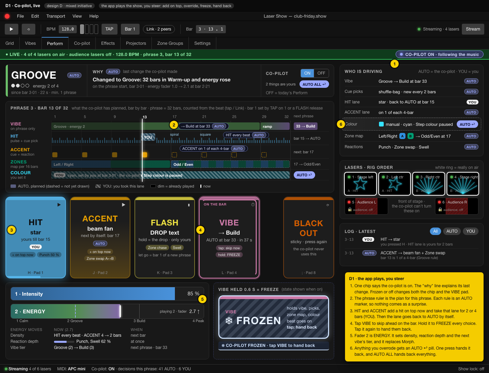
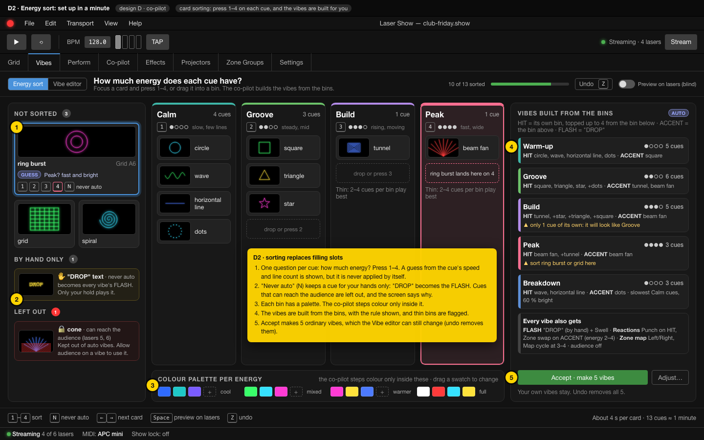
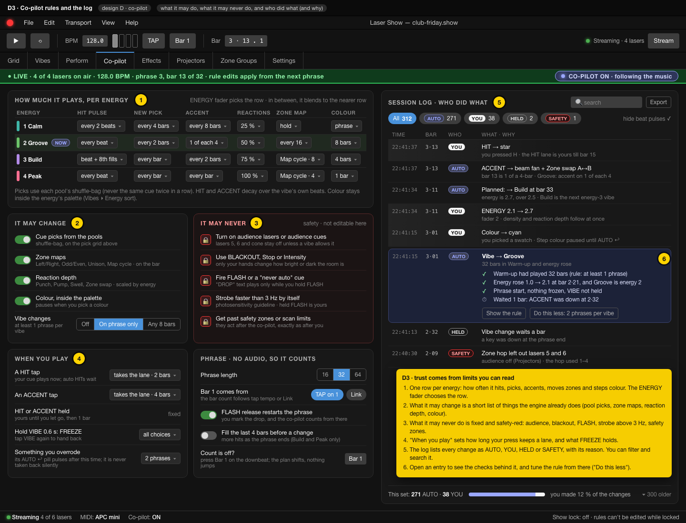

# D. Co-pilot

**The app plays a sensible show from the beat and the phrase. The performer steers it, and every automatic move is marked, explained, and can be frozen or handed back with one press.**

Inspired by: BEYOND Virtual LJ, "like having two laserists" (r01 §2.1); SoundSwitch Autoloops (r02 #12); rekordbox Lighting's AUTO pills (r02 #13); the "running, but not from this control" border (r01 #16); the mixed-initiative findings in r04 §2 (Horvitz, Coyle); and r04 rules 14 and 15.

## The idea
A **co-pilot** plays the roles by itself, using engine features that already exist. It pulses HIT on the beat, picks new cues from the shuffle-bags, fires ACCENT on the 1 of each 4-bar, and changes zone maps and vibes on phrase boundaries. The performer's presses **add on top** (each one takes that lane for a few bars), **override** a colour or a map, or **freeze** the co-pilot's choices. Fader 2 becomes **ENERGY**, the one thing the app cannot hear. Every automatic change carries an AUTO mark, a one-line "why" and a log entry. With the co-pilot off, Perform works exactly as it does today.

**Who it's best for:** DJs who also run the lasers, and new users who want a good show on the first night. Experienced buskers can turn it off.

## How it answers the pain points

| | How | |
|---|---|---|
| P1 Busking load | The co-pilot plays the beat. Live decisions come down to "more or less energy" plus the odd skip, freeze or drop | strong |
| P2 Easy grouping | Energy sort: one keypress (1–4) per cue, and the vibes are built for you | strong |
| P3 Presses move effects | Reaction depth follows energy, and the pads and the log name the reactions. Reactions are still made in the Vibe editor | partial |
| P4 Rig setup | Uses today's Projectors tab unchanged | not addressed |
| P5 Zone effects live | Zone maps change on the bar, shown in the ZONES lane. There is no new live zone control | partial |
| P6 Truth | AUTO and YOU tags, the why line, a ruler showing the plan, the log, honest laser tiles | strong |
| P7 Concepts | Pool, bed, FX set and Morph leave Perform. Co-pilot, energy, phrase and lane arrive | partial |
| P8 Safety | A locked "never" list. BLACKOUT, FLASH and audience stay human-only | strong |

## Screens

- The LIVE band carries a violet **CO-PILOT ON · following the music** chip. When frozen or off, both the chip and the VIBE pad change, so the state has two signs (r04 rule 8).
- The **why** line explains the last automatic change, here "Changed to Groove: 32 bars in Warm-up and energy rose" (r04 rule 14).
- The **phrase ruler** shows bars 1–32 with the playhead at bar 13, and the plan as AUTO markers: "→ Build at bar 33", "HIT every beat" with the next picks drawn ahead from the bag, "ACCENT on 1 of each 4-bar", and Odd/Even zones at bar 17. Bars already played are dimmed.
- HIT is tagged **YOU**: the performer just added a star and owns the lane until bar 15. ACCENT pulses as AUTO. FLASH is "only yours". VIBE is queued for Build (tap: skip, hold: FREEZE). BLACKOUT stands apart.
- **ENERGY** has four detents, a ghost mark for the tier being played (2) and the fader position (2.7). A small table under it says what energy moves, and when.
- **Who is driving** lists the owner of each part. The manual colour has an **AUTO ↩** pill to hand it back, and **AUTO ALL** hands back everything (r02 #13, r01 #15).
- The laser tiles are in rig order. Audience lasers 5 and 6 are hatched, with the note "the co-pilot can't turn these on".

- A card sort inside the Vibes tab. The focused card takes **1–4**, **N** (never auto) or **Space** (blind preview on the lasers).
- A **GUESS** chip suggests a bin from the cue's speed and line count. It is never applied by itself.
- "DROP" is **by hand only** and becomes every vibe's FLASH. **cone** can reach the audience, so it is left out, and the screen says why (V6).
- Each bin has a colour palette, and the co-pilot steps colour only inside it.
- The preview builds the vibes with a visible rule. HIT comes from the vibe's own bin, topped up to 4 cues from the bin below. ACCENT comes from the bin above. Bins with too few cues get a warning.
- **Accept** makes 5 ordinary vibes that you can still edit, and undo removes them. This meets r04 rule 24 (a playable vibe in under a minute).

- A **density table** has one row per energy level: HIT pulse, new pick, ACCENT, reaction depth, zone map and colour step. Edits apply from the next phrase.
- **It may change** lists only what the engine already does. Vibe changes can be Off, On phrase only, or Any 8 bars.
- **It may never** is locked and safety-red (r04 rule 20). It covers audience lasers and cues, BLACKOUT/Stop/Intensity, FLASH and never-auto cues, strobe above 3 Hz by itself (the photosensitivity guideline), and anything that would get past the safety zones.
- **When you play** sets how long a press keeps its lane and what FREEZE holds. An override is never taken back silently: its AUTO ↩ pill pulses instead.
- **Phrase** says plainly that there is no audio, so the app counts bars. You choose 16, 32 or 64 bars and take bar 1 from TAP or Link. A FLASH release can restart the phrase, and a Bar 1 button fixes the count.
- The **log** lists each change as AUTO, YOU, HELD or SAFETY, with its reason, and you can filter it. An opened entry shows its checks and a "Do this less" button. The footer shows how many of the changes were yours (12 %).

## Interaction details

| Control | Press | Hold | Release |
|---|---|---|---|
| **HIT** | Plays the next pool cue now. The auto HIT lane waits 2 bars, then resumes with your cue | the lane is yours | AUTO returns after 1 bar |
| **ACCENT** | Same, from the ACCENT pool. The lane waits 4 bars | same | same |
| **FLASH** | The drop: flash cue and flash FX. Only a human fires it | on while held | the look returns, and the phrase can restart at bar 1 |
| **VIBE** | Skips to the next vibe on the bar. While frozen, a tap **hands back** | 0.6 s: **FREEZE** (a latch) holds the vibe, picks, map and colour. The pulse goes on | — |
| **BLACKOUT** | Sticky dark. The co-pilot keeps counting bars | — | press again |
| **Fader 1** | Intensity, as today | | |
| **Fader 2** | ENERGY 1–4 sets density (from the next bar), reaction depth (at once) and the next vibe's tier (at the next phrase) | | |

Holding HIT or ACCENT is a quasimode (r04 rule 7). FREEZE is a latch on purpose, since nobody can hold a key through a breakdown, so it gets two signs and a one-tap exit.

**What the co-pilot decides.**
- **Each beat:** the HIT pulse re-triggers the current cue's decay.
- **Each bar line:** new picks from the shuffle-bag, drawn ahead so the ruler can show them, and an ACCENT with its tap reactions (such as Zone swap) at the depth energy sets. Colour steps inside the palette.
- **Every 8–16 bars:** a zone map switch, with the existing switching on the bar.
- **At the end of a phrase:** a vibe change, if four things are true: the vibe has played its minimum, energy points to another tier, nothing is frozen, and no key is down (today's phrase-gap check). If a key is down, the change waits a bar and is logged HELD.

**Setup**, after the rig:
1. Make cues on the Grid tab.
2. Open Vibes ▸ Energy sort and press 1–4 on each card (about 1 minute).
3. Accept.
4. Learn the 5 keys and 2 faders.
5. Switch the co-pilot ON, then TAP on the downbeat.

Time to first show: **about 3 minutes**.

## What it reuses and what is new
**Reuses:** vibes and their energy dots; shuffle-bag pools; decay and Restart on; tap reactions; zone maps, Map cycle and patterns; the Phase 5 Fader modulator (the ENERGY value drives reaction amounts); the VIBE lock; auto-advance's phrase-gap check; the audience rule; show lock; the watchdog.

**New:**
- Co-pilot scheduler: rule table, look-ahead plan, lane yield and hand-back. **L**
- Bar and phrase counter, with Bar 1, Link phase and the FLASH re-anchor. **M**
- ENERGY fader that replaces Morph, and the choice of tier. **M**
- Phrase ruler. **M**
- Who-is-driving panel, AUTO pills and the manual colour override. **M**
- FREEZE scope, its pad and chip states, and the AUTO pulse on the LEDs. **S**
- Why line and session log. **M**
- Co-pilot tab. **M**
- Energy sort and the vibe builder. **M**
- GUESS heuristic. **S**

**Total:** about 30–50 dev-days.

## Decisions it touches
- **V1** (five buttons, two faders): kept. HIT and ACCENT now mean "add on top".
- **V2** (sticky blackout): kept. The co-pilot never uses it.
- **V5** (Intensity + Morph): **changed on purpose.** ENERGY replaces Morph while the co-pilot is on, and a vibe's Morph target joins "reaction depth". With the co-pilot off, Morph returns.
- **G3** (energy as a slider was rejected): **reopened on purpose.** Without audio analysis, energy is the one input the app can't infer. It stays optional: co-pilot off means no energy fader.
- **V6 / V10** (audience): kept, and hard-locked.
- **V8 B** (vibe stuff on its own tabs): kept. D adds a Co-pilot tab and an Energy sort mode inside Vibes.
- **Auto-advance:** becomes part of the co-pilot. With the co-pilot off, it is unchanged.
- **Zones:** one render per cue per tick (invariant 8) is kept, because the co-pilot only fires the existing triggers and map switches. D-29 is kept.
- **V3, V4, V7, V9:** not affected.

## Risks and trade-offs
- **"Everything looks the same"** (r02 §4, rekordbox). This is softened by per-tier pools and palettes, visible picks, separate density rows, "Do this less", and drops that stay human. A three-hour set may still feel samey.
- **Agency.** Correct help can still lower the sense of agency (Coyle), and DJs distrust automatic visuals. This is softened by lanes that yield to presses, the "yours" gauge, and a one-click OFF.
- **No audio.** The bar count from tap or Link can't hear a breakdown or an early mix, so phrases drift. Correcting them depends on the FLASH re-anchor and the Bar 1 button.
- **Screen density.** D1 goes past four concepts (r04 rule 25). A full-screen show mode could hide the right column.
- **Name clash.** The existing "Energy" tap reaction needs a new name, such as "Tap rush".

## Open questions
1. Should a HIT press take the lane (as drawn) or layer on top of the auto pulse?
2. Should energy drift along an arc when the fader doesn't move?
3. Should FREEZE be a latch (as drawn) or hold-only?
4. Should the chip honestly say "following the beat"?
5. Should repeated overrides suggest a rule change after the set?
