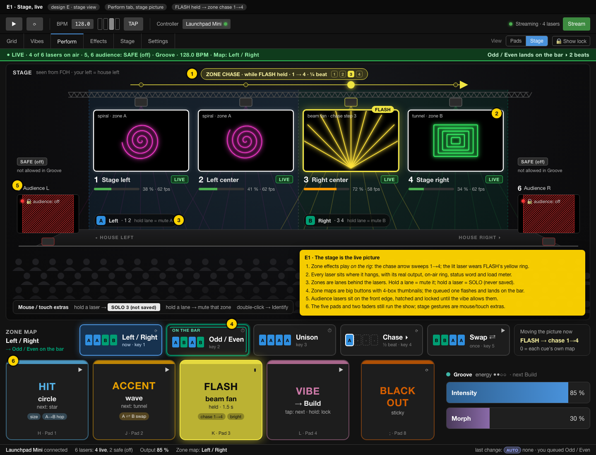
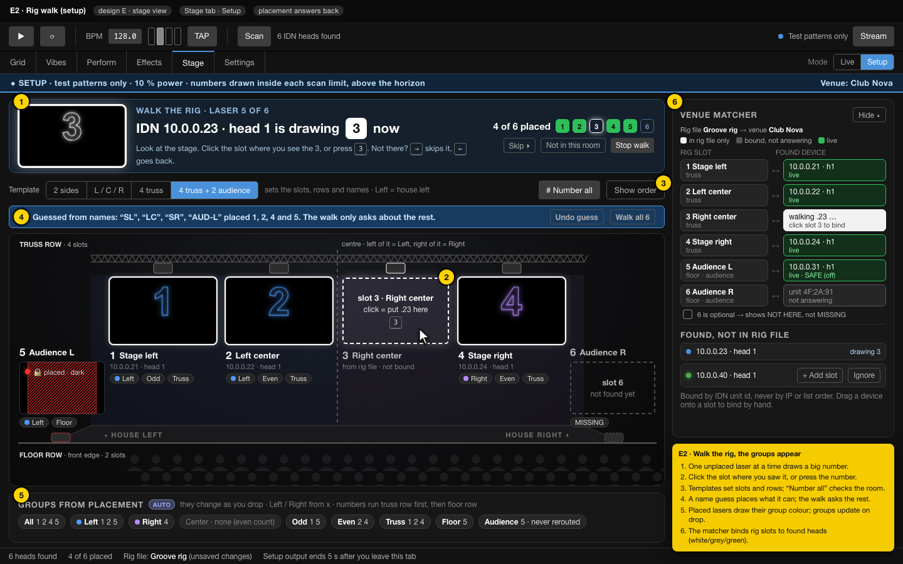
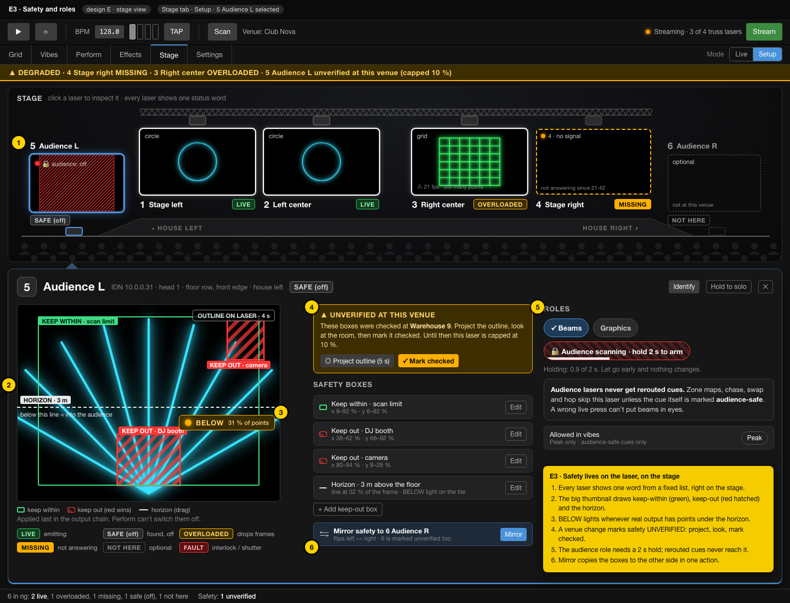

# E. Stage view

**The main picture is the stage, seen from the audience: every laser is drawn where it hangs, showing what it draws right now, and you set up the rig, pick zones and play zone effects on that one picture.**

Inspired by: Hue Entertainment's "placement that answers back" (r05 #3), grandMA3 layouts and Highlight/Solo (r05 #10, #11), BEYOND's zone keypad and mini maps (r01 #2, #3, r05 #19), the L-Acoustics Unit Matcher (r05 #5), LaserOS keep-within/keep-out zones and the PASS horizon light (r05 #14, #15), and natural mapping (r04 rule 18).

## The idea
Today the rig is spread over three screens: the Projectors strip, Zone Groups and Perform's "No Preview" boxes. Design E merges them into one **stage picture** that looks like the room. It has a truss row, a floor row and the audience. Zones are lanes behind the lasers, and each tile shows the real output. In Setup mode you place and check lasers on this picture. In Live mode it is Perform's main view. The five pads and two faders still run the show. The stage shows what they did and adds a few gestures for mouse or touch.

**Who it's best for:** operators with 4–8 lasers in more than one row (truss + floor + audience scanners), who play in many venues and want to read the rig at a glance.

## How it answers the pain points

| | How | Rating |
|---|---|---|
| **P1** Busking load | Pads and faders unchanged; the stage replaces the "No Preview" boxes. | partial |
| **P2** Easy groups | Groups come from placement; the laser draws its group colour on drop (E2). | strong |
| **P3** Presses move effects | Moved lasers wear the pad's colour (r04 rule 13); chips stay on pads. | partial |
| **P4** Rig setup | Walk, templates, Number all, name guess, matcher; rows fit audience lasers. | strong |
| **P5** Zone effects live | Map buttons with thumbnails; chase/swap/shift drawn on the rig itself. | strong |
| **P6** Screen honesty | Real output per tile, on-air ring, load meter, fixed status word (r05 #6). | strong |
| **P7** Too many concepts | "Lane", "split", "middle laser" go; a zone is a coloured area. Map/pattern/reaction remain. | partial |
| **P8** Safety | Boxes and horizon on the tile, BELOW light, UNVERIFIED, 2 s arm, no reroutes to audience (E3). | strong |

## Screens

- Lasers 1–4 hang on the truss. Lasers 5–6 sit on the front edge, hatched and SAFE (off), because Groove does not allow audience scanning.
- Zone A (blue) is painted behind 1–2 and zone B (green) behind 3–4. The map is named in the band and on the strip.
- FLASH is held, so Zone chase sweeps 1→4: an arrow along the truss, step pips, and FLASH's yellow ring on laser 3, the one lit now.
- The zone-map strip, each button with a 4-box thumbnail (r01 #2): Left/Right is lit, Odd/Even is queued for the bar, and 0 returns to each cue's own map (r05 #19).
- Gestures: hold a laser to SOLO it (never saved, r05 #11), hold a lane to mute it, double-click to Identify. Show lock turns them off.
- The pads and faders are unchanged. A Pads / Stage switch keeps today's view.

- The walk lights one unplaced laser at a time, drawing a big number. IDN 10.0.0.23 · head 1 is drawing **3**: click the slot where you see it, or press 3 (r05 #4).
- Templates (2 sides, L / C / R, 4 truss, 4 truss + 2 audience) set slots, rows and names, and the screen states "Left = house left" (r05 #12).
- The guess from names placed 1, 2, 4 and 5, so the walk only asks about the rest. "Number all" makes every laser draw its number (r05 #2).
- Placement answers back: placed lasers draw their group colour, and the groups row updates on drop (r05 #3).
- The venue matcher binds rig slots to found heads by IDN unit id. White = rig file only, grey = not answering, green = live (r05 #5). "Optional" turns MISSING into NOT HERE.
- Setup output is test patterns only, at 10 % power, inside each scan limit and above the horizon.

- Each laser shows one fixed status word: LIVE, SAFE (off), OVERLOADED, MISSING, NOT HERE, FAULT (r05 #6).
- Selecting 5 Audience L opens its inspector under the stage.
- Its thumbnail draws the green keep-within box, the red hatched keep-out boxes (red wins, r05 #14) and a draggable **horizon**. **BELOW** lights when real output goes under it (r05 #15).
- UNVERIFIED AT THIS VENUE (amber): project the outline, look, mark checked. Until then the laser is capped at 10 % (r05 #17).
- Role chips: Beams, Graphics, Audience scanning. The audience role needs a 2 s hold to arm. Rerouted cues never reach it unless the cue is marked audience-safe (r05 §4).
- "Mirror safety to 6 Audience R" is one action, using the existing mirror feature.

## Interaction details

| Control | Press | Hold | Release |
|---|---|---|---|
| **HIT** ▶ | plays the next pool cue, and the lasers it lands on flash blue | — | — |
| **ACCENT** ▶ | plays an accent and its zone reaction (e.g. A⇄B swap, drawn as an arrow between lanes) | — | — |
| **FLASH** ▮ | — | flash look on; Zone chase sweeps on the stage | the bed comes back |
| **VIBE** ▶/⏱ | next vibe on the bar | lock the vibe | — |
| **BLACKOUT** ⟳ | dark at once; the whole stage dims and the band turns vermillion | — | press again to leave (sticky) |
| **Intensity** | master level; the tiles dim with it | | |
| **Morph** | unchanged | | |
| Zone-map keys `1–5`, `0` | queue a map on the bar; 0 = each cue's own | — | — |
| Hold a laser (mouse/touch) | — | SOLO, with "SOLO n (not saved)" in the band | restores everything |
| Hold a lane | — | mute that zone | unmute |

Every stage gesture is a quasimode (r04 rule 7). None of them opens anything, and show lock turns them off.

**Setup steps**
1. Scan. The app finds the heads and guesses the order from names and IPs.
2. Pick a template, and the slots appear.
3. Walk the rest (about 10 s per laser).
4. Check the groups row, and drag to fix if needed.
5. Audience lasers: keep-out boxes, horizon, project, mark checked, hold to arm.
6. Save the rig file. At the next venue the matcher rebinds by unit id.

**Time to first show:** about 3 minutes for 4 truss lasers, and 6–8 minutes with two audience lasers (mostly the safety check, on purpose).

## What it reuses and what is new

**Reuses:** the rig strip order and the automatic groups (All/Left/Right/Center/Odd/Even), zone maps with switch on the beat, zone patterns and the zone reactions (hop, swap, shift, chase), safety rectangles, Identify, the rig file, the per-projector thumbnails and load meters, the audience rule (V6/V10), the Perform pads and faders, and copy/mirror safety.

**How 2-D maps onto today's 1-D order.** Each laser gets `x` (0–100, house left = 0) and a new `row` field (truss, floor, or a custom row). Rig order = rows from top to bottom, then x within each row. Everything that reads the order today (Odd/Even, chase order, map lanes) keeps working unchanged. Left/Right/Center are still computed, now from x against the centre line. The "middle laser split" becomes a draggable centre band. Old rig files get `x` spread evenly from their order and `row = truss`, so nothing breaks.

**How zone effects are drawn.** A map is the lane colours. A pattern step is an arrow, step pips and the lit laser in the role colour (or with an AUTO tag when the beat moved it). A swap is a double arrow between lanes. A shift slides the lanes by one laser.

| New piece | Size |
|---|---|
| `x` + `row` per laser in the model and rig file, plus migration | S |
| Stage-view rendering (truss, rows, placed tiles, lanes, audience) | L |
| Zone-map strip with thumbnails and the queued state | M |
| Zone-effect overlay driven by the engine's step state | M |
| Stage gestures (solo while held, lane mute, Identify) | M |
| Rig walk, Number all, guess from names | M |
| Templates | S |
| Venue matcher (slots ↔ found, unit-id binding, optional) | M |
| Fixed status vocabulary | S |
| Horizon line and BELOW detection | M |
| UNVERIFIED-at-venue state with a power cap | M |
| Audience hold-to-arm, and reroutes kept off audience lasers | S |
| Merge Projectors + Zone Groups into a Stage tab | M |

**Total:** 1 L + 8 M + 4 S ≈ 7 + 32 + 6 ≈ **45 working days (about 9 weeks)**.

## Decisions it touches
- **V1 (five buttons, two faders):** kept for the core, but **stretched on purpose**. The zone-map strip adds up to 5 optional second-hand keys, and the gestures are extras. On a 5-pad controller the strip can be hidden, and the vibe's own maps run by themselves.
- **V2** sticky blackout: kept. **V5** Intensity + Morph: kept.
- **V6 / V10** audience rule: kept and tightened. Audience lasers also never receive rerouted cues, and their role needs a 2 s hold to arm.
- **V8 B** vibe stuff on its own tabs: kept. The Stage tab replaces Projectors and Zone Groups, not Vibes.
- **Zones D-5 / D-12** (cues don't know the rig): kept, because cues still name only zones. **Invariant 8** (one render per cue per tick): kept, because the stage only reads the output. **D-29** safety applied last: kept.

## Risks and trade-offs
- **Screen space.** At 1000 px the tiles shrink to about 120 px, so the Pads view stays as a fallback.
- **Big rigs.** With 12+ lasers, tiles become dots with a thumbnail on hover, which loses some honesty.
- **A front view hides depth.** Front and back truss at the same height overlap. Height (2.5-D) is left out.
- **The walk needs to see the beam.** Without haze or a wall, the numbers are hard to read.
- **More live buttons.** The zone strip and the gestures work against P1/P7 for some operators.

## Open questions
1. The mockup content uses names like "1 Stage left" placed on the house-left side. Should templates rename lasers in house terms (house left/right, as Pangolin does) to avoid a stage-left/house-left mix-up?
2. Should Odd/Even count across all rows (1–6) or within each row?
3. Should the zone-map strip have its own controller row (Launchpad bottom row), or stay on the keyboard (`1–5`, `0`)?
4. Can IDN tell us anything about a head's position or give a hardware identify, so the walk could be skipped?
5. Is lane-mute a useful live tool, or one concept too many (P7)?
