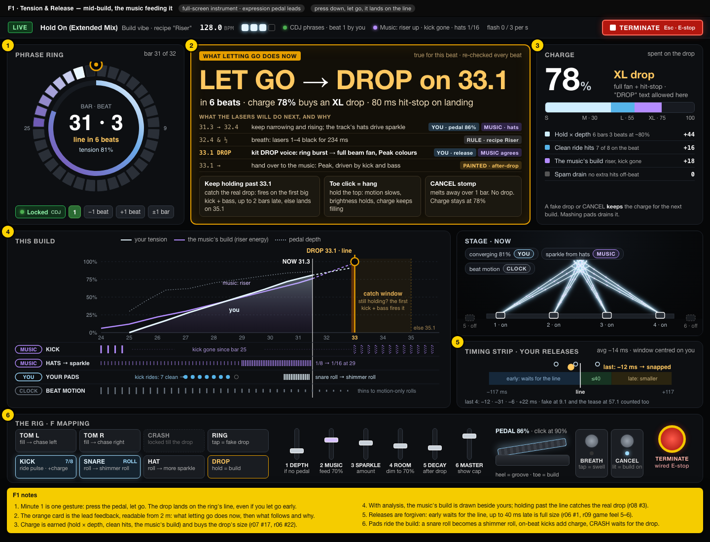
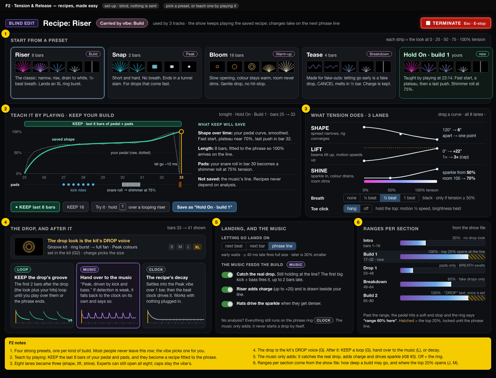
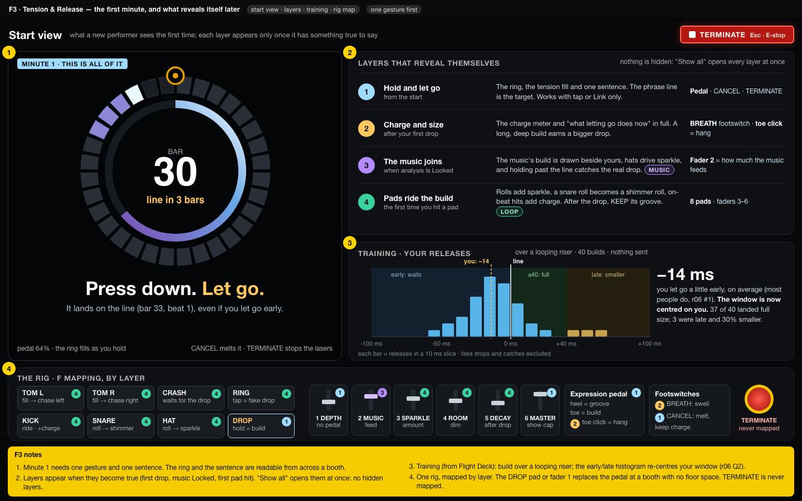

# F. Tension & Release

**Press the pedal down, let go, and the drop lands on the phrase line, sized by the charge your build earned. The music's own build, pads riding along and the after-drop handover are depth that appears only when it has something true to say.**

Inspired by: the break routine and ITPRA (r06 §4, #5–#7, #22), the tension pedal (r09 #4), game feel (r09 game feel 4–6, 9), star power (r07 #17), the drop catcher and fill accents (r08 #3, #12), and live looping (r07 #10).

## The feeling

The DJ pulls the kick out and I push the pedal forward. The beams pull in, rise and go white, and the screen says one thing I can read from the back of the booth: **LET GO → DROP on 33.1**. I roll a snare on a pad and the build shimmers; the track's own riser climbs beside my line. The DJ holds two extra bars, so I keep my foot down, and the rig catches the real drop on the first kick and bass. Then the music takes over and my feet rest.

## How it maps music to light

| Input or event | Musical meaning | What the lasers do | Why (perception) |
|---|---|---|---|
| Pedal down, over time | the build | tension 0→100%: SHAPE narrows, LIFT tilts and speeds up (3× cap), SHINE sparkles, drains colour, dims the room | Tension rises as an expected event nears (r06 §4); a build is one long gesture (r09 #4) |
| Let go (early / ≤ 40 ms late / later) | "now drop" | the kit's DROP voice lands on the phrase line (waits / full size / 30% smaller) | Release on the downbeat (r06 #5, #9); tap-ahead (r06 #1); buffering, coyote time (r09 game feel 5–6) |
| Charge | how good the build was | hold × depth + clean pad hits + the music's build → S/M/L/XL drop; XL adds the 80 ms hit-stop | Star power (r07 #17); peak budget (r06 #22); hit-stop (r09 game feel 4) |
| Toe click (90%) | the riser hangs | hang: motion at half speed, brightness held | Hang time (r09 game feel 9) |
| Holding past the line (analysis Locked) | the DJ extends the build | **catch**: the first big kick + bass fires the drop, up to 2 bars late | Drop catcher (r08 #3); a build is detectable, a drop only once it lands (r08 §1.5) |
| The music's riser, kick gone, hats 1/8 → 1/16 | the track's own build | a second line beside yours, up to +20 charge; hat density drives sparkle | Above 4 Hz is texture (r06 #19) |
| Pad rolls during a build | a fill | snare roll → shimmer roll, hat roll → sparkle, tom fills → chases | Fill accents (r08 #12); hit density (r07 #5) |
| Auto breath | the cut before the drop | ½ beat black on lasers 1–4, only if tension ≥ 50% | Silence before an expected event (r06 #7; unverified) |
| CANCEL, or a fake drop (RING pad) | a tease | melts over 1 bar; **charge is kept** | Thwarted expectation (Meyer, r06 §4) |
| After the drop | the groove | KEEP it as a loop, hand over to the music, or decay | Live looping (r07 #10); lanes (r08 #4) |

## Screens

- **The orange card leads**: "LET GO → DROP on 33.1" at 54 px, then **what the lasers will do next, and why**, each line tagged YOU, MUSIC, RULE or PAINTED. Below it are the alternatives: keep holding (catch), toe click (hang), CANCEL.
- **Phrase ring** at bar 31 · 3, with tension as an inner arc, the Locked · CDJ chip, the "1" button and nudges.
- **Charge** (78%, XL), split into its sources so the performer learns what earns it.
- **This build**: your line and the music's riser side by side, the catch window, and four lanes with source chips (KICK and HATS from MUSIC, YOUR PADS from YOU, BEAT MOTION from CLOCK).
- **Timing strip** of releases (last: −12 ms → snapped), and **the rig's F mapping**: pads riding the build, 6 faders, the pedal with its toe click, BREATH, CANCEL and TERMINATE.

- **Four presets** (Riser, Snap, Bloom, Tease) with 0–100% thumbnails. The vibe picks one, so most people never edit.
- **Teach it by playing**: KEEP the last 8 or 16 bars of pedal and pads. The curve is smoothed and fitted to the phrase, and a snare roll becomes a shimmer roll at that tension. The music's line is never saved.
- **Three lanes instead of eight** (SHAPE, LIFT, SHINE), plus one row each for breath and toe click.
- **The drop look is the kit's DROP voice** (G2). **After the drop** you choose: KEEP the groove (LOOP), hand over to the music (MUSIC: "Peak, driven by kick and bass", which falls back to the clock if detection is weak), or decay (CLOCK).
- **Landing and the music**: the snap target, plus three toggles for what the music adds. With all of them off, everything runs on the ring.
- **Ranges per section** from the show file (for example, Breakdown 60% with fake drops only). The hatched top 20% opens only at the line.

- **Start view**: a giant ring and "Press down. Let go." That is all of minute 1.
- **Layers reveal themselves**: charge after the first drop, the music when it is Locked, and pads on the first hit. "Show all" opens every layer at once.
- **Training** over a looping riser: an early/late histogram re-centres the window (−14 ms). The rig map numbers each control by its layer.

## What changed from the first version

- Minute 1 is **one gesture and one sentence**; charge, music and pads appear later as layers.
- "If you let go now" became the **huge lead card**, with a list tagged by who decided each step.
- **Charge** replaces "size follows tension": the drop is earned, fakes keep the charge, and spam drains it.
- **The music feeds the build** (a second line, sparkle, and **catch on the real drop**). Before, audio could only "agree".
- **Pads ride the build**, and the drop is the kit's DROP voice: F and G share one kit.
- **After the drop is a choice** (KEEP, music, decay), not a fixed decay.
- Recipes went from eight lanes to **three lanes, four presets and teach-by-playing**, plus ranges per section.

## Borrowed from

| Part | From | Why it fits here |
|---|---|---|
| Pads ride the build; the DROP voice | G | Hands stay busy in long builds; one drop look for the family |
| KEEP the drop's groove | G | Frees hands and feet right after the peak |
| The music's build line, hats → sparkle | L | Confirms the build visibly; never fires |
| Catch on the real drop | L, r08 #3 | Fixes the old worst case: DJs who extend builds |
| Hand over: "Peak, driven by kick and bass" | L | After the drop, the music drives best |
| CDJ phrases, "what will happen and why" | K | A trustworthy ring, and a reason on every line |
| Training histogram; top 20% locked | M | Learnable timing; the peak stays rare |
| Ranges per section; hang time | J | The show sets limits; the performer plays inside them |

## Learning curve

- **Minute 1.** Press down when the music builds, let go when it should drop. It lands on the line.
- **Hour 1.** Learn what earns charge. CANCEL teases and keep the charge. Hang on long risers. Pick an after-drop choice per vibe.
- **After a month.** Catch extended builds, fake twice and drop XL on the third, teach a recipe per track, and write ranges per section.

## What it needs

| Part | Detail | Size |
|---|---|---|
| Phrase ring and release scheduler | r08 level 0; CDJ phrases at level 3 | S–M |
| Tension engine (3 lanes, caps) and charge | | M |
| Pads, DROP voice, KEEP | shared with G | S |
| Music feed and catch | riser, kick-gone, hats, kick + bass (r08 level 1) | L |
| F1/F3 surfaces, F2 editor, training | | M + M |
| **Total** | about 5 weeks without audio, 8–9 with it | |

**Cheap prototype:** a USB pedal, a pad controller, one Riser recipe and the big card. Log release offsets for two days, then add catch on a band-pass kick + bass detector.

## How it fits the existing app

It is a **"Build" mode on Perform**. Vibes carry recipes, G's kit gives the pads and the DROP voice, and L's lanes are the handover target. The show clock, zones, the Feel engine and the safety layers carry over unchanged.

## Safety

- **TERMINATE** is in the same top-right spot on every screen (Esc and the wired E-stop) and is never mapped. CANCEL is creative, not safety.
- **Scanners 5–6** never take recipes, drops, catches or loops unless the show allows them.
- **Flashes**: the breath and the drop count inside the 3 per second limit. Sparkle is texture, and the music never raises brightness.
- **Honest**: the card always says what letting go does. A catch only fires while you hold with catch on, and it is labelled MUSIC.

## Risks and open questions

- **Catch can misfire** on a fake kick in a riser. It needs kick + bass together and a confidence gate.
- Repeated XL drops may lose their contrast; does charge need a per-set budget?
- **Teach-by-playing** may save sloppy curves. How much smoothing is right?
- The pre-drop breath is still untested (r06 Q4). Revealing layers must never move a control (r07 §4 #5).
