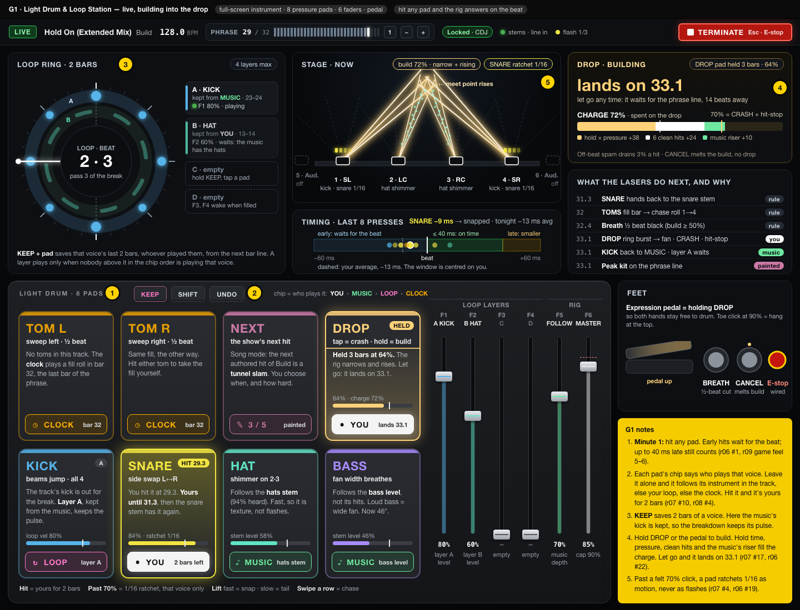
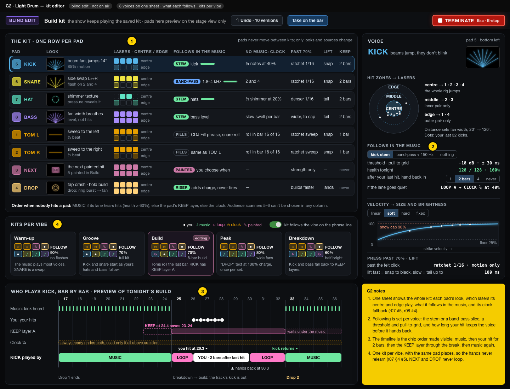
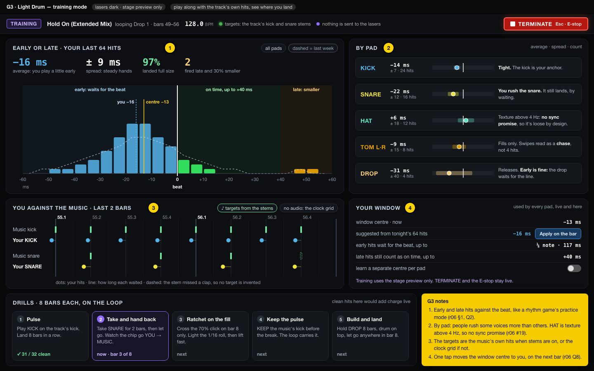

# G. Light Drum & Loop Station

**Hit any pad and the rig answers on the beat. Leave a voice alone and the music plays it for you. Hold DROP to build, and let go to land it.**

Inspired by: Sensory Percussion hit zones (r07 #5), RC-505 layering (r07 #10), dipping (r07 #1), the two-stage press and lift speed (r07 #2, #4), song mode (r07 #7), star power and the peak budget (r07 #17, r06 #22), instrument lanes and the confidence HUD (r08 #4, #7), forgiving timing and hit-stop (r06 #1, r09 game feel 4–6), and motion over flash (r06 #17–19).

## The feeling

The hats and bass already shimmer with the track before I touch anything. I hit SNARE and it's mine for two bars, then it slides back to the music. Before the kick drops out, I tap KEEP + KICK and the loop keeps the pulse through the break. On the riser I lean on DROP with one hand and roll the snare with the other. I let go somewhere in bar 31, and it lands on 33.1 with a crash and a freeze.

## What changed from the first version

- **Idle voices follow the music.** In round 2 an idle pad was dark. Now its source chip (YOU · MUSIC · LOOP · CLOCK) shows it playing its own instrument in the track.
- **Hit to take, let go to hand back.** A hit gives you the voice for 2 bars. There are no mute buttons and no mode switch.
- **KEEP replaces OVERDUB.** It saves 2 bars that already happened, yours or the music's. The ring shows only the lanes in use, and its layers sit on F1–F4.
- **DROP is a pressure pad with charge.** Tap it for a crash; hold it to build. The pad CRASH freed became NEXT (song mode).
- **Fewer, bigger things.** The flash limiter is now a chip, timing is one strip, and the zone diagrams live in the editor. The pads take half the screen.
- **The shared rig** (8 pads, 6 faders, a pedal, two footswitches and the E-stop) is drawn on G1. A **training mode** (G3) is new.

## How it maps music to light

| Gesture or event | Musical meaning | What the lasers do | Why (research) |
|---|---|---|---|
| Hit any pad | a drum hit | that voice's look, on the beat; early hits wait, up to 40 ms late counts | tap-ahead and forgiveness (r06 #1, r09 game feel 5–6) |
| Leave a voice alone | the band keeps playing | it follows its stem: KICK the kick, HAT the hats, BASS the level | one-to-one sound→light lands hardest (r07 §4 #10, r08 #4) |
| Hit a following voice | "I'll take this one" | YOU for 2 bars after your last hit, then it hands back on the beat | a quasimode with no mode switch (r04 §8) |
| Stem goes quiet or health < 60% | breakdown, or weak detection | falls to that voice's KEEP layer, else the clock pattern | fallback order YOU › MUSIC › LOOP › CLOCK (r08 #4, #7) |
| KEEP + pad | "keep this groove" | the last 2 bars of that voice loop from the next bar line | layered looping (r07 #10); record and re-time (r08 #15) |
| Velocity | loudness | size and brightness, soft curve, 25% floor, 90% show cap | loudness ↔ size (r06 §6) |
| Press past the 70% click | a roll, intensity | a 1/16 ratchet on that voice only, as motion | two-stage press (r07 #4); > 4 Hz is texture (r06 #19) |
| Lift fast / slow (HAT, BASS) | choke vs ring out | snap to black, or a tail up to the voice's decay | lift speed = decay (r07 #2) |
| Swipe a row of 4 | a fill | a chase across lasers 1→4 in that direction | glissando chase (Beam Harp N); fill accents (r08 #12) |
| NEXT | the song's own hits | the next authored hit of the section, at your moment and strength | song mode (r07 #7) |
| Hold DROP (or the pedal) | the build | the rig narrows, rises and drains to white; charge fills | tension grows towards the expected event (r06 §4, #5) |
| Clean on-beat hits while building | the drummer driving the riser | add charge; off-beat spam drains 3% per hit | star power (r07 #17) |
| Let go of DROP | "now" | lands on the phrase line; ≥ 70% charge adds CRASH and an 80 ms hit-stop | peak budget (r06 #22); hit-stop (r09 game feel 4) |

## Borrowed from

| Part | From | Why it fits here |
|---|---|---|
| Source chip and stem following | L | It is the drummer's "band": the pads you aren't playing still groove |
| KEEP from a stem | L | A breakdown without drums keeps its pulse, built from the music itself |
| Hold-to-build, charge, release on the line | F | The biggest moment is still played by the fingers, and still lands on time |
| Pedal = DROP, BREATH, CANCEL | F | The foot builds while both hands keep drumming |
| Two-stage press, lift speed, velocity cap | H (Colour Organ) | They add depth to each pad with no extra controls |
| Song mode (NEXT), sweep = chase | N (Beam Harp) | Painted looks are played with a drummer's timing, and fills feel physical |
| Training histogram, input buffer | M (Flight Deck) | They make the forgiving window visible and tunable |
| Fill bar → chase roll; "next, and why" list | K (Song Highway) | The clock's toms have a job, and every change is predicted |

## Screens

- **The pads take half the screen.** Each shows its look, a one-line *why*, a pressure bar with the 70% click and a big source chip.
- **The moment shown is bar 29 of 32, building into the drop.** KICK is on LOOP (the music's kick, kept before the break) and SNARE on YOU, ratcheting with 2 bars left. HAT and BASS are on MUSIC, and the toms on CLOCK. DROP is held at 72% charge.
- **Loop ring:** one 2-bar circle. Layer A plays; layer B waits because the music has the hats.
- **Drop card:** "lands on 33.1" in big type, with the charge split by source and a 70% mark for CRASH + hit-stop.
- **What the lasers do next, and why**, tagged rule / you / music / painted.
- **Faders:** F1–F4 are the loop layers, F5 is FOLLOW (music depth) and F6 is MASTER (under the cap). The feet are drawn too.

- **One row per pad:** look, centre/edge lasers, what it follows (with health), clock fallback, past-70%, lift and KEEP length.
- **Inspector (KICK):** hit zones with your last 32 hits, follow source, threshold, hand-back time, velocity curve with floor and cap.
- **Kits per vibe:** each pad's default source and the FOLLOW amount. Pad places never move. *Take on the bar* swaps kits.
- **Who plays KICK, bar by bar:** the chip order as a timeline (MUSIC → LOOP → YOU → LOOP → MUSIC).

- An early/late histogram with per-pad averages ("you rush the snare"), played against the stems' own hits, or the clock grid with no audio.
- One tap moves the window centre to your average. Five 8-bar drills teach each layer. The lasers stay dark.

## Learning curve

- **Minute 1:** hit any pad. It lands on the beat. The music is already playing the other voices.
- **Hour 1:** take and hand back on purpose, KEEP the kick before a break, hold DROP over a riser and land it, and use the 70% ratchet on fills.
- **After a month:** zone play, ghost notes, NEXT for the song's signature hits, kits per vibe, and building charge with clean snare rolls so the drop that matters earns the CRASH. A drummer can play it from a real kit.

## What it needs

| Part | Size |
|---|---|
| Feel engine: window, quantiser, flash limiter (shared) | S |
| Voices, zones, velocity curve, two-stage press, lift | M |
| Source arbiter (YOU › MUSIC › LOOP › CLOCK, hand-back, health) | M |
| KEEP ring: a rolling 2-bar buffer per voice, 4 layers | M |
| DROP build and charge (shared with F) | S–M |
| Stem lanes (band-pass first, shared with L) | M–L |
| G1, G2, G3 screens and the rig's MIDI map | L |
| **Total** | **≈ 6–8 weeks; ≈ 4 without stems (CLOCK and LOOP only)** |

**Analysis:** level 0 (tap, Link or CDJ phrase) is enough: then MUSIC is greyed out and the chip goes YOU › LOOP › CLOCK. Level 1 band-pass lanes turn MUSIC on (r08).

**Cheap prototype:** an €80 pressure-pad controller, 4 band-pass lanes in Web Audio, and only KICK, SNARE and DROP. The test: does hand-back feel natural, and does finger-drumming light feel tight?

## How it fits the existing app

It is a **Drum** mode on Perform, full-screen live. Vibes carry kits, reactions become voices, zones give the centre/edge sets, and the show clock drives the ring. It shares stem lanes with L and the build engine with F.

## Safety

- **TERMINATE** (Esc and the wired E-stop) sits in the same spot on every screen. It is never a pad and can't be mapped.
- **Audience scanners 5–6** can't be chosen in any kit column. Neither MUSIC, LOOP nor DROP can reach them.
- **Flashes:** at most 3 full-field flashes per second, and a 4th becomes motion. Ratchets and hats are motion or texture only.
- **No hidden layers:** every voice shows who drives it, every layer is on the ring and a fader, and the "next, and why" list predicts each change.

## Risks and open questions

- **Will hand-back surprise people?** Two bars may be too short for sparse players. It is set per kit, with "never" as an option.
- **Stem latency** (23–92 ms) is too slow for MUSIC on the kick (r08 §1.6). Band-pass lanes or real DAW stems may be needed.
- **Loops get dull:** a 2-bar KEEP over 8 bars may need slow variation per pass (r07 #13).
- **Pressure feel varies by controller.** The 70% click needs a felt detent, or LED and haptic feedback.
