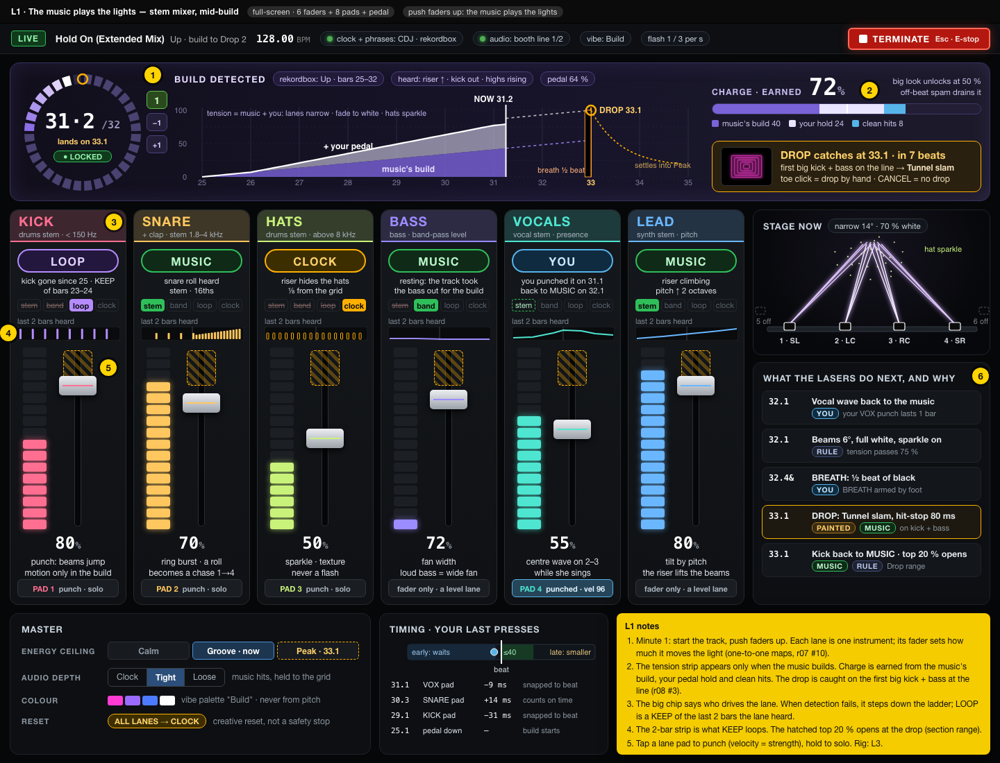
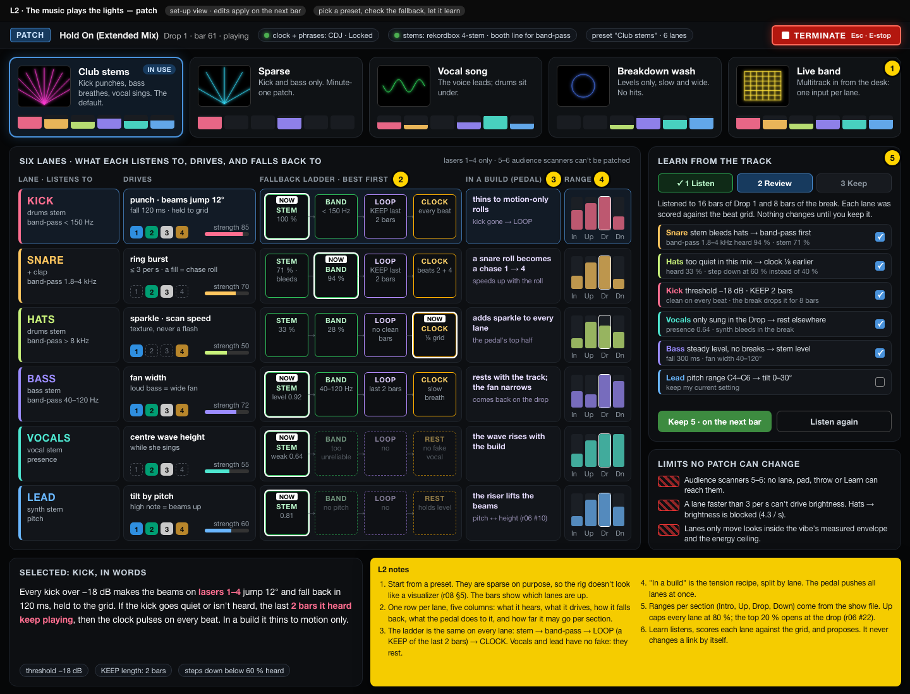
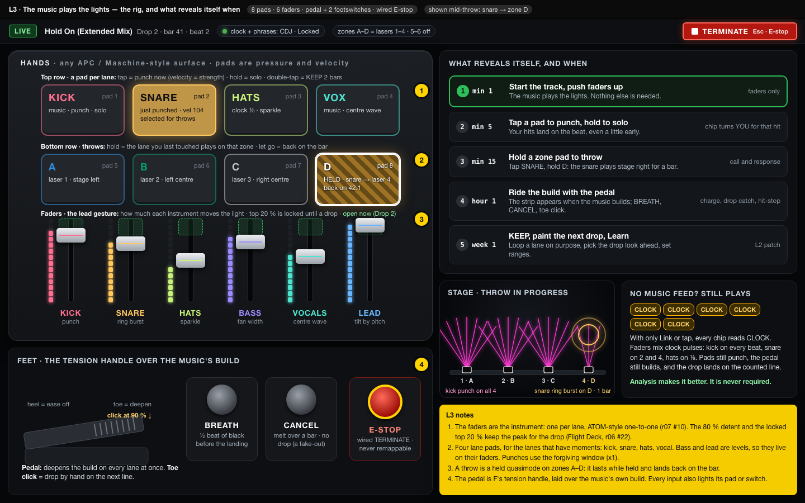

# L. The Music Plays the Lights

**Start the track and push the faders up: the track's own instruments play the lasers, and you mix them. Pads punch a lane in, KEEP holds a lane when the music drops it, and a pedal deepens the music's own build into a caught drop.**

Inspired by: ATOM's one-to-one sound-to-light mapping and Henke's Lumière (r07 §2.7, #10), instrument lanes, the audio-depth knob, the energy ceiling, the drop catcher and phrase data (r08 #3–#7, #10–#12, §1.5, §7), cross-modal maps such as loudness ↔ size and pitch ↔ height (r06 §6, #10), and the peak budget (r06 #22). The supporting layers come from F (the tension handle) and G (pads and KEEP).

## The feeling

I push the faders up and the kick jumps the beams, the bass breathes the fans, and the vocal draws a wave. When the DJ pulls the kick for the build, the kick lane goes to LOOP: the last two bars it heard keep pulsing, so the room never goes dead. BUILD DETECTED lights up across the top. I rock the pedal and every lane narrows and goes white, I tap BREATH, and the first big kick catches the drop. I didn't fire it. I mixed it.

## How it maps music to light

| Input or event | Musical meaning | What the lasers do | Why (perception) |
|---|---|---|---|
| Fader per lane (6) | "how much this instrument drives the light" | scales that lane's link; at 0 the lane is silent | Strict one-to-one maps land hardest (ATOM, r07 #10); Greenewalt's fader per colour (r07 §2.7) |
| Kick onset | the pulse | punch on 1–4: beams jump 12°, fall in 120 ms | Sharp onsets plus motion feel on the beat (r06 §7, #17) |
| Snare onset; a roll | backbeat; a fill | ring burst on 2–3 (≤ 3/s); a roll becomes a chase 1 → 4 | Fill accents (r08 #12) |
| Hats | fast subdivision | sparkle, never a flash | Above 4 Hz it is texture (r06 #19) |
| Bass level · vocal presence · lead pitch | floor · voice · melody | fan width · centre wave · tilt (high note = up) | Loudness ↔ size; pitch ↔ height (r06 §6, #10) |
| Lane pad tap (velocity) / hold | "this one, now" / "only this" | punches the lane now at that strength / solos it | Velocity ↔ brightness on a soft curve (r06 §6) |
| Zone pad held (A–D) | a DJ throw | the last lane you touched plays on that laser for a bar | A held quasimode (r04 §8 rule 3) |
| Lane loses its signal | detection failed, or the track dropped it | steps down: stem → band-pass → LOOP (KEEP of 2 bars) → CLOCK | The pulse is felt even without sound (r06 §1); weak lanes fall back (r08 #4) |
| Music build detected | riser, kick out, highs rising | the tension strip appears; tension rises with the music | A build can be detected before the drop (r08 §1.5) |
| Pedal depth | "push the build harder" | all lanes narrow, cross-fade to white, sparkle rises from hats | Tension grows as the event nears (ITPRA, r06 §4) |
| BREATH | the cut before the drop | ½ beat of black before the landing | Silence before an expected event (r06 #7; not lab-verified) |
| Charge | the earned payoff | fills from the music's build + your hold + clean hits; off-beat spam drains it; ≥ 50 % unlocks the big look | Star power, peak budget (r07 #17, r06 #22) |
| Drop | the payoff | caught on the first big kick + bass at the line; painted look, 80 ms hit-stop | Drop catcher (r08 #3); hit-stop (r09 game feel 4) |

## Screens

- **Six big lanes**: one large **source chip** (YOU · MUSIC · LOOP · CLOCK), a tall meter by the fader, and one line saying what it drives. The other numbers moved to L2.
- **The ladder** under each chip shows the active step: kick is on LOOP (the track removed it), hats on CLOCK (the riser hides them).
- **Last 2 bars heard** is always recording, so KEEP never starts from nothing. **The hatched top 20 %** is the section range; the drop opens it.
- **The tension strip** is shown only while a build is detected. It has the phrase ring (bar 31·2 of 32, Locked, "1" and nudges), the build graph (music's build plus your pedal, stacked), the breath band, and the drop target. **Charge** shows what earned it, and the **drop catch** card shows the painted look, *Tunnel slam*.
- **Next, and why** tags each coming change: you, rule, painted or music. **Master** is simpler: ceiling tiers, a three-way depth switch, the vibe's palette.

- **Presets first** (Club stems, Sparse, Vocal song, Breakdown wash, Live band). Most people never go further.
- **One row per lane, five columns**: listens to, drives, fallback ladder, in a build, range per section.
- **The ladder is honest**: kick, snare, hats and bass can fall back to a LOOP or the CLOCK. Vocals and lead have no fake, so they *rest*.
- **Learn from the track**: Listen, Review per lane, Keep on the next bar. It never changes a link by itself.

- **The rig**: faders = lanes. Top pads KICK, SNARE, HATS, VOX (tap = punch, hold = solo, double-tap = KEEP); bottom pads = zones A–D for throws. Pedal = tension, toe click = drop by hand, plus BREATH, CANCEL and the E-stop.
- **What reveals itself, and when**, in five steps. **No music feed**: every chip reads CLOCK and it still plays.

## Learning curve

- **Minute 1.** Start the track and push the faders up. The lights follow the music. Pull a fader down and that instrument leaves the light.
- **Hour 1.** Punch the vocal on its big line; throw the snare to D. When the strip appears, rock the pedal, tap BREATH, let the kick catch the drop. Run Learn once per venue.
- **After a month.** Ride faders like EQ. KEEP a groove through a breakdown on purpose. Paint the next drop. Fake out with CANCEL and catch the third drop by hand. Write section ranges.

## What it needs

| Part | Detail (r08 ladder) | Size |
|---|---|---|
| Phrase ring and clock | Link or tap plus counted phrases; CDJ phrases through Beat Link Trigger (levels 0, 3) | S–M |
| Audio DSP | line in, FFT, per-band onsets, levels, presence, loudness (level 1) | M–L |
| Lanes and ladder | per-lane health against the grid; step down at a threshold; a 2-bar ring buffer per lane for KEEP | M |
| Build detector and drop catch | riser, kick-out and highs-rising heuristics, fused with phrase data; catch on kick + bass at the line | M |
| Tension layer | F's tension engine laid over all lanes; charge; breath; hit-stop | S (shared with F) |
| Pads, throws, KEEP | the Feel engine's forgiving window; zone routing; loop playback | S (shared with G) |
| L1, L2, L3 surfaces and MIDI map | lanes, strip, presets, ladder, Learn | M |
| Real stems | 2a: multitrack from a DAW or desk (S–M). 2b: an ML separator (L, licensed) | — |
| **Total** | band-pass version with tension and pads ≈ 9–11 weeks; +1–2 weeks for 2a | |

**Cheap prototype first:** loopback audio into a Web Audio page with four band-pass lanes, each with a 2-bar buffer, a cheap MIDI fader-and-pad box and a USB pedal, sending OSC. In 4–5 days we learn whether LOOP beats CLOCK in a breakdown and whether the drop catch lands on time.

## How it fits the existing app

A **Mix mode** beside Perform. Lanes are new reaction sources; zones carry the throws; vibes carry presets, palettes and tension recipes; the show clock is the bottom of every ladder. It shares the tension engine with F and the pad engine and KEEP buffer with G: a G voice set to MUSIC is an L lane.

## Safety

- **TERMINATE** is top right on every screen, on Esc and on the wired E-stop. It cannot be remapped. ALL LANES → CLOCK and CANCEL are creative only.
- **Audience scanners 5–6** take nothing from lanes, pads, throws, Learn or the drop.
- **Flashes**: lanes above 3/s can't drive brightness; the breath and drop count against the limiter (r06 #18).
- **Envelope**: audio moves looks only inside the vibe's envelope, the ceiling and the section range.
- **Fail safe**: a dead feed steps lanes down to LOOP, CLOCK or rest. Nothing freezes at full.
- **No hidden layers**: every lane shows who drives it; "next, and why" lists what is coming.

## What changed from the first version

- **Fewer numbers, bigger meters.** Gain and fall knobs, health percentages and the 4-bar timeline left the live screen; one big source chip per lane replaced them.
- **KEEP replaced "fall to the clock" as the first fallback**, so a lane that loses its signal keeps its own groove for two bars.
- **Source chips now use the shared vocabulary**, YOU · MUSIC · LOOP · CLOCK, with a visible ladder.
- **Pads were added**: a punch and solo per lane, plus zone throws on the second row, instead of zone-send buttons on every strip.
- **The music's build now drives a tension layer**, with the pedal, BREATH, charge and a caught drop. Before, L had no build–drop arc at all.
- **The 13-column patch grid became five columns plus presets**, with the ladder and the per-lane build behaviour in plain words.
- **Section ranges, palette colour and a simpler master** (a three-way depth switch, ceiling tiers) replaced the free knob and tube.

## Borrowed from

| Part | From | Why it fits here |
|---|---|---|
| A pad per lane: tap = punch, hold = solo | G | Gives the mixer a way to make a moment without leaving the faders |
| KEEP (2-bar loop) as a fallback step | G | It keeps the lane's own groove, which is better than a generic clock pulse |
| Tension handle, BREATH, CANCEL, charge, hit-stop | F | Turns the detected build into something you can shape, not only watch |
| Drop catch on kick + bass at the line | F + r08 #3 | The music lands the drop, and your hand can still overrule it |
| Phrase data, "next, and why" list, painting the next drop | K | The build and the drop are known ahead, so they can be shown and prepared |
| Ranges per section | J | Stops a fader from spending the peak in a build |
| Top 20 % locked until the drop | M | A felt limit at the top of every fader |
| Colour from the vibe's palette | I | Lanes move shape and motion; mood keeps the colour |

## Risks and open questions

- **False builds.** The strip only arms; it never fires a drop without phrase data or a kick on the line. How often does it appear wrongly in real sets?
- **When should LOOP stop?** A kick KEEP through a long breakdown could fight the music. Default: 8 bars at 40 %, then rest. Needs testing.
- **Stem latency and licensing.** Real-time separators add 23–92 ms (r08 §1.6), near the ~45 ms limit; several libraries can't be licensed (r08 §1.8).
- **Four lane pads for six lanes.** Bass and lead live only on their faders. Is that enough, or do they need a pad page?
- **Visualizer look.** Presets must stay sparse, and audio depth should start at Tight.
